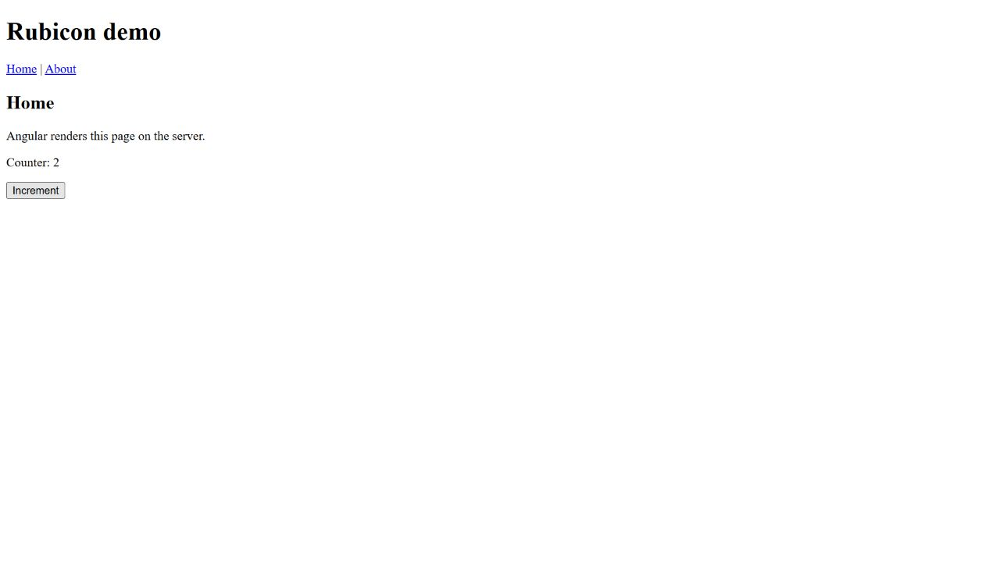

# Experiment 005: Browser Assets and Hydration Through Rust

**Status:** Completed temporary check; author implementation pending
**Created:** 2026-10-11
**Last updated:** 2026-10-11
**Type:** HTTP and browser integration correctness check; not a benchmark
**Source revision:** `6427722`
**Application:** Angular 22.2.2, existing neutral development build
**Proposed dependency:** tower-http 0.6.11 with fs
**Implementation scope:** Temporary Rust and generated-application copies; repository source unchanged

## Question and Result

Can Rust serve the browser files belonging to the embedded Angular SSR build, and can the browser hydrate and interact with those pages?

Yes, for the reference application checks below. The temporary host served main.js, styles.css, and favicon.ico with correct content types and bytes matching the copied build output. Home and About retained their SSR behavior. Angular reported hydration on both direct page loads, the Home counter changed from zero to one to two, About navigation and reload worked, and returning to Home created a counter at zero. Captured warning/error logs were empty.

The actual repository now renders Angular HTML through Rust as recorded in [experiment 004](004-angular-http-adapter.md#repository-verification). The asset service checked here is a proposal awaiting author implementation. The conventional Node.js server was not used for these requests or browser interactions.

## Proposed Dependency

Add this line under dependencies in crates/rubicon/Cargo.toml:

```toml
tower-http = { version = "=0.6.11", features = ["fs"] }
```

The exact version was already present in the local Cargo registry and was inspected for ServeDir behavior. The fs feature enables the file service and its dependencies. Run the first cargo check without --locked so Cargo can update Cargo.lock for the changed manifest. Later checks should use --locked. Do not copy the diagnostic lock file into the repository.

## Proposed Routing Change

Add this import in crates/rubicon/src/main.rs:

```rust
use tower_http::services::ServeDir;
```

Keep the existing Angular module path and Renderer startup. Replace the current app router construction:

```rust
    let app = Router::new()
        .route("/", get(root))
        .route("/{*path}", get(root))
        .with_state(renderer);
```

with:

```rust
    let browser_path = Path::new(env!("CARGO_MANIFEST_DIR"))
        .join("../../examples/angular-demo/dist/rubicon/browser");

    let ssr = Router::new()
        .route("/", get(root))
        .route("/{*path}", get(root))
        .with_state(renderer);

    let app = Router::new().fallback_service(
        ServeDir::new(browser_path)
            .append_index_html_on_directories(false)
            .fallback(ssr),
    );
```

The ssr router retains the current page handler and renderer state. The outer router delegates requests to ServeDir, which looks for files in the browser output directory and uses ssr when a file is missing. Existing page routes must be moved into that fallback router; leaving a wildcard page route on the outer router would select it before the file service.

Use fallback rather than not_found_service because successful Angular pages must keep their 200 status. Disable automatic index.html lookup for directories so the root request reaches the Angular renderer. The entire matching browser directory is served, including generated development source maps and copied public assets. The server output directory is outside the configured file root.

There is no new render path for static files, no custom MIME detection, and no manual binary-to-text conversion. File responses use the service's own body and HTTP metadata handling. The page adapter remains buffered.

## Temporary Verification Method

A checked temporary root contained a Rust crate copy and a copy of the actual, freshly rebuilt dist/rubicon output, including both server and browser directories. No Angular source edit or rebuild was needed for this proposal. The Rust copy added the dependency and router code above and adjusted both generated-artifact paths to the copied directories.

The temporary package was rubicon-browser-assets-probe-b89bd60a, with library name rubicon and the corresponding copied-lock root-package rename. A new package identity forced the current extension source paths to compile. Its bind address and fixed application origin used the same available loopback port, 61097.

The first all-target cargo check resolved dependencies offline and updated only the copied lock file. It added tower-http 0.6.11, http-range-header 0.4.2, mime_guess 2.0.5, and unicase 2.9.0. It also selected older cached versions of js-sys, the wasm-bindgen family, wasip2, and wit-bindgen compared with the repository lock. That resolution is specific to the local offline cache; the declared direct dependencies retained their pins. The checked target was native Windows, not WebAssembly or WASI. The repository lock was preserved, and the author's dependency resolution will be reviewed separately.

After compilation and tests, the copied server was started with a hidden window. HTTP checks compared downloaded asset SHA-256 hashes with the copied files and checked HEAD metadata. A background browser tab then loaded the same server for hydration and interaction checks. The agent-created tab was closed, the tracked server process was stopped, and the checked temporary root was removed after verification.

## Commands and Rust Checks

```text
cargo fmt --manifest-path <copy>/Cargo.toml
cargo check --offline --manifest-path <copy>/Cargo.toml --all-targets --target-dir <repository>/crates/rubicon/target
cargo test --locked --offline --manifest-path <copy>/Cargo.toml --target-dir <repository>/crates/rubicon/target
cargo build --locked --offline --manifest-path <copy>/Cargo.toml --bin <temporary-package> --target-dir <repository>/crates/rubicon/target
```

All commands passed. Eight library tests, four executable tests, and all six renderer fixtures passed. One macro-generated documentation example was ignored. LNK4098 persisted.

## HTTP Results

```text
ASSET_PROBE_PAGE_OK GET / 200 1670 bytes
ASSET_PROBE_PAGE_OK GET /about 200 1583 bytes
ASSET_PROBE_PAGE_OK GET /missing 404 9 bytes
ASSET_PROBE_PAGE_OK GET /?sort=asc&page=2 200 1670 bytes
ASSET_PROBE_PAGE_OK HEAD / 200; empty body and matching Content-Length
ASSET_PROBE_FILE_OK /main.js 200; SHA-256 matched; HEAD empty; text/javascript
ASSET_PROBE_FILE_OK /styles.css 200; SHA-256 matched; HEAD empty; text/css
ASSET_PROBE_FILE_OK /favicon.ico 200; SHA-256 matched; HEAD empty; image/x-icon
ASSET_PROBE_MISSING_OK /missing.js 404
ASSET_PROBE_MISSING_OK /server.mjs 404
ASSET_PROBE_MISSING_OK /angular-app-manifest.mjs 404
ASSET_PROBE_MISSING_OK /assets/not-present.css 404
```

Successful page responses contained their expected Home/About heading, SSR marker, and hydration annotations. The fallback body was exactly Not found. HEAD page metadata matched the checked GET representation. All three existing asset downloads matched their files byte-for-byte through SHA-256 comparison; asset HEAD responses had no body and Content-Length equal to the file size.

The two server-artifact paths returned 404, verifying those specific files were not exposed at those URLs. This is not a general security audit, symlink policy check, or exhaustive path validation. The file service's path parsing was inspected in the pinned implementation, but this experiment did not perform a traversal request.

## Browser Results

| Check | Observation |
| --- | --- |
| Direct Home load | Title Home &#124; Rubicon demo; heading Home; counter zero. |
| Home hydration diagnostic | 2 components and 25 nodes hydrated; 0 components skipped. |
| First and second Increment clicks | Counter one, then two. |
| About navigation | About title, heading, and reference text appeared at /about. |
| Direct About reload | Page loaded again; 2 components and 19 nodes hydrated; 0 skipped. |
| Return through Home link | Home counter zero in a new component instance. |
| Captured warning/error logs | Empty after the checked sequence. |

These node counts describe the current development templates and may change with valid markup edits. The counter and reload checks establish selected browser behavior; they do not establish general server request isolation.



The screenshot records the temporary Rust host after browser hydration and two Increment clicks. It is not a screenshot of the author's pending asset implementation.

Local evidence remains only in ignored crates/rubicon/target/browser-assets-probe.log, browser-assets-browser.json, browser-assets-server-stdout.log, browser-assets-server-stderr.log, and browser-assets-probe-Cargo.lock. The diagnostic metadata names a stopped process and removed source copy; those paths are not deployment artifacts.

## Author Implementation and Reproduction

1. Add the dependency and import, then replace the router block as shown above.
2. From the repository root, update the dependency lock once and run the checks:

   ```text
   cargo check --manifest-path crates/rubicon/Cargo.toml --all-targets
   cargo fmt --manifest-path crates/rubicon/Cargo.toml
   cargo check --locked --manifest-path crates/rubicon/Cargo.toml --all-targets
   cargo test --locked --manifest-path crates/rubicon/Cargo.toml
   ```

3. Preserve the matching dist/rubicon/server and dist/rubicon/browser outputs. Rebuild them if the Angular application has changed:

   ```text
   npm.cmd run build -- --configuration development,rubicon
   ```

4. Stop an older Rubicon process on port 3000, then start the executable from the repository root:

   ```text
   cargo run --locked --manifest-path crates/rubicon/Cargo.toml
   ```

5. Check asset metadata and the page fallback:

   ```text
   curl.exe -I "http://127.0.0.1:3000/main.js"
   curl.exe -I "http://127.0.0.1:3000/styles.css"
   curl.exe -i "http://127.0.0.1:3000/about"
   curl.exe -i "http://127.0.0.1:3000/missing"
   ```

6. Open http://127.0.0.1:3000/ in a browser, inspect the hydration diagnostics, click Increment twice, navigate to About, reload it, return to Home, and inspect warnings/errors.

After actual repository verification, commit the manifest, Cargo.lock, router change, and updated evidence together.

## Limits and Remaining Work

This establishes the tested development browser behavior through a single embedded worker and file service. Production configuration, static cache policy, compression, deployable artifact configuration, native services, request identity/context isolation, memory/resource cleanup, deadlines, cancellation, worker replacement, and performance evaluation remain separate work.

The runtime decision remains Draft. The next development milestone should be selected from these unresolved requirements before making performance claims or comparing production hosting configurations.

## Sources

- Installed tower-http 0.6.11 Cargo.toml and src/services/fs/serve_dir/mod.rs, inspected locally.
- Actual [Rust HTTP Angular integration](004-angular-http-adapter.md#repository-verification).
- Actual [neutral build configuration](../../examples/angular-demo/README.md#neutral-build-for-rubicon).
- Existing [Node.js browser reference](../../examples/angular-demo/README.md#browser-hydration-check).
- [Runtime selection ADR](../adr/001-runtime-selection.md).
