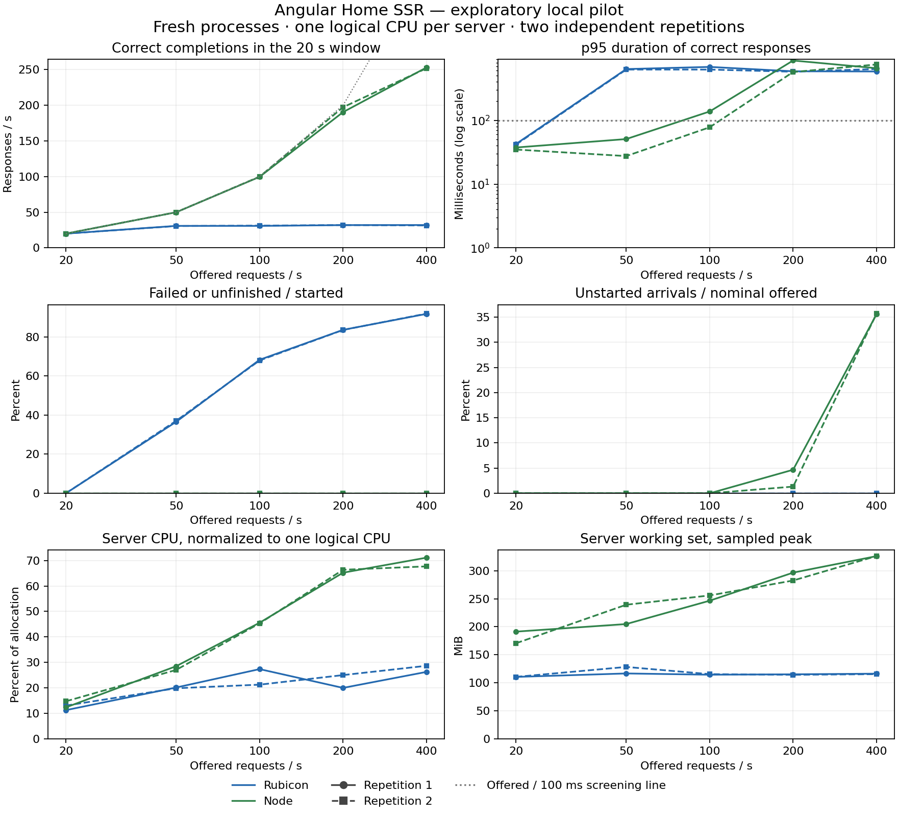

# Experiment 006: Exploratory Angular SSR Performance Pilot

**Status:** Completed exploratory pilot; full thesis evaluation pending
**Created:** 2026-10-11
**Last updated:** 2026-10-11
**Type:** Local W-01 dynamic Home SSR load test
**Tested source and harness revision:** `91637e8155556458d5eb866404a2b0a0bc02ccea`
**Application implementation base:** `c825d3277ab50d7113419f1ede3497d1368522c9`; no framework/application source changes in this experiment
**Measurement session:** 2026-10-11, 07:41:27–07:53:31 UTC
**Evidence:** [manifest](../../benchmarks/results/2026-10-11-w01-pilot-001/manifest.json), [run order](../../benchmarks/results/2026-10-11-w01-pilot-001/plan.json), [results CSV](../../benchmarks/results/2026-10-11-w01-pilot-001/results.csv), [complete per-run results](../../benchmarks/results/2026-10-11-w01-pilot-001/results.json)

## Question and Result

At which offered rates do the current implementations begin to exhibit latency, incorrect responses, rejection, or unstarted arrivals on this laptop?

For this small page and configuration, the Node reference delivered more correct work at lower latency than the current Rubicon host. Both repetitions passed the exploratory criteria at 20 requests/s for Rubicon and at 20 and 50 requests/s for Node. Node at 100 requests/s passed in one repetition and failed the latency criterion in the other. Rubicon rejected requests with HTTP 503 from 50 requests/s onward and delivered approximately 31–32 correct responses/s in the overloaded runs.

These are observations about the tested implementations. The largest tested rates passing both repetitions are 20/s and 50/s, respectively; they are not exact maximum capacities. No Rust speedup or sustained-capacity claim is supported. The pilot identifies a useful next investigation: wall-clock time inside the single embedded worker and its queue, rather than assuming CPU saturation.

## Configuration and Comparability

The frozen [configuration](../../benchmarks/pilot/config.json) uses five offered rates: 20, 50, 100, 200, and 400 requests/s. Each variant/rate combination has two independent runs. Every run starts a fresh server, performs HTTP gates, warms Home at 20/s for 10 seconds, settles for two seconds, and measures for 20 seconds. The second repetition reverses rate order; variant order alternates within each repetition. A fixed warm-up does not demonstrate JIT or memory convergence.

The client is k6 2.3.0 with a constant-arrival-rate executor. Measurement has 128 preallocated/maximum virtual users, HTTP keep-alive, identity encoding, no redirects, no TLS, a two-second request timeout, and a three-second graceful drain. Only Home HTML is requested during load. There is no configured HTML cache and both production builds prerender zero routes. Static assets are checked outside the measurement; this is not an asset-delivery benchmark.

The Rust executable is optimized release. The Node reference imports the generated production Express/Angular request handler and binds it to loopback, preserving its rendering and file middleware. Rubicon uses its current single persistent rendering worker, one active render, and 16 waiting jobs. Different admission policies, response-writing paths, runtime integrations, and engine versions are part of this whole-implementation comparison.

| Item | Recorded value |
| --- | --- |
| Angular | 22.2.2, production builds; browser JS/CSS/favicon hashes identical between variants |
| Rust / PowerShell | rustc 1.97.1 / PowerShell 7.6.5 |
| Node / its V8 | v24.19.0 / 13.6.233.17-node.51 |
| Embedded V8 | 15.0.245.2-rusty, binding 150.4.0; release-linked diagnostic |
| Hardware | AMD Ryzen AI 7 350, 8 physical / 16 logical processors; 33,598,976,000 bytes RAM |
| OS / power | Windows 11 Pro 10.0.26300 x64; Balanced power plan |
| Server allocation | One logical CPU, mask 1, for either complete server process |
| Generator allocation | Logical CPUs 2 and 4, mask 20; GOMAXPROCS=2 |
| Resource sampling | CPU time, working set, private bytes and affinity every 500 ms |

No hard memory cap is imposed. Affinity masks do not prove separate physical cores or exclude SMT contention. Windows, other applications, frequency scaling, thermals, and the controller remain uncontrolled. The substantial V8 version difference prevents attributing observed differences solely to Rust versus Node hosting.

The screening criteria, declared before the full run, are correct-response p95 ≤100 ms, failures among started requests ≤0.1%, zero dropped arrivals, recovery checks passing, and generator mean CPU below 85% of its allocation. These are exploratory local criteria, not an established application SLA.

## Correctness and Harness Validation

[Preflight](../../benchmarks/pilot/preflight.json) records the checks and retained invalid smoke runs. The first warm-up offered 100/s with 16 virtual users and dropped arrivals; both smoke runs were rejected as invalid. Before freezing the full configuration, warm-up was reduced to 20/s and the measurement grid narrowed. The replacement smoke passed for both variants. These short checks are not performance evidence.

An independent local fixture returned correct HTML, deliberately incorrect counter content, and HTTP 503. The actual k6 categories exactly matched the fixture: 4 correct, 4 incorrect-content, and 3 HTTP 503 responses. Its threshold exit 99 was expected. Compact replay reproduced both replacement smoke summaries byte for byte.

Before load, the exact production artifacts passed browser checks through Rust release and Node: initial counter zero, two increments, About navigation and direct reload, and Home return at zero. Captured warning/error lists were empty. [Rust evidence](../assets/angular-pilot-release-counter.jpg) and [Node evidence](../assets/angular-pilot-node-counter.jpg) preserve the counter state. A subsequent neutral rebuild produced the same verified artifact hashes.

Every full run passed Home/About/query/HEAD/404 HTTP gates and post-load Home/About recovery. Each measured response was checked for status 200, HTML content type, expected headings, SSR/hydration annotations, and counter zero. This checks the reference page, not arbitrary HTML equivalence. The application has no personalized data or native service; identity isolation and general cleanup are not established.

All 20 full runs had valid measurement accounting, correct warm-ups, observed affinity masks, recovery, and generator headroom. No full run was excluded. Here, valid means interpretable accounting and preflight, not passing the performance criteria. Overload results remain visible.

## Measurements

Ranges below are the minimum and maximum of the two independent run values. They are not confidence intervals. Percentiles are calculated independently for each run with Type-7 interpolation; they are not averaged or pooled across trials. Correct throughput counts completions inside the 20-second window. Latency uses the complete correct-request cohort, including the recorded drain tail.

| Variant | Offered /s | Correct /s in window | Correct p95 ms | HTTP 503 count per run | Dropped arrivals per run | Runs passing / 2 |
| --- | ---: | ---: | ---: | ---: | ---: | ---: |
| Rubicon | 20 | 20.00 | 41.6–42.5 | 0 | 0 | 2 |
| Node | 20 | 20.00 | 34.8–37.5 | 0 | 0 | 2 |
| Rubicon | 50 | 30.65–30.85 | 624.9–635.5 | 366–371 | 0 | 0 |
| Node | 50 | 49.95–50.00 | 27.5–50.8 | 0 | 0 | 2 |
| Rubicon | 100 | 30.85–31.20 | 624.2–687.2 | 1,360–1,366 | 0 | 0 |
| Node | 100 | 99.65–99.95 | 77.8–137.5 | 0 | 0 | 1 |
| Rubicon | 200 | 31.95–32.05 | 577.5–586.6 | 3,343–3,345 | 0 | 0 |
| Node | 200 | 190.45–197.30 | 571.6–865.7 | 0 | 53–187 | 0 |
| Rubicon | 400 | 31.45–32.05 | 583.1–636.7 | 7,342–7,355 | 0 | 0 |
| Node | 400 | 251.95–253.05 | 655.2–750.2 | 0 | 2,846–2,855 | 0 |

Across measurement cohorts, the nominal schedule totals 61,600 arrivals. The recorded counts are 55,673 started and completed, 30,825 correct, 24,848 HTTP 503, 5,941 unstarted, and zero unfinished requests. All measured failures were HTTP 503 from Rubicon; no incorrect-content, other-status, or transport failures were recorded. Scenario boundaries account for 14 more started/dropped events than the nominal total; every run's schedule residual was zero or −1 and within the declared one-request tolerance.

Of the correct cohort completions, 358 occurred after their measurement windows and are retained separately: 139 on Rubicon and 219 on Node. They are not added to within-window throughput. The totals across different load levels are accounting checks, not comparative throughput statistics.

Node's zero failed started requests at 200/400 does not mean it served the offered load successfully. Longer response times exhausted the 128-user client limit and reduced actual starts. Generator mean CPU ranged from 0.72% to 11.55% across all runs, but low CPU does not remove the virtual-user concurrency constraint. These overloaded points cannot establish sustainable capacity, and nonmonotonic latency across rates must be interpreted alongside actual starts and dropped arrivals.

The [SVG](../../benchmarks/results/2026-10-11-w01-pilot-001/pilot.svg) is available for export. Lines only connect the tested points; behavior between rates was not measured.

## Resource Observations and Interpretation

At the equivalent successful load of 20/s, Rubicon's sampled working-set peak was 110.4–110.5 MiB and Node's was 170.5–191.3 MiB. Server CPU was 11.2–13.0% versus 12.3–14.7% of the one-logical-CPU allocation. CPU time per correct completion within the resource-sampling interval was 5.6–6.5 ms versus 6.2–7.3 ms. These short observations do not establish a general memory reduction, a CPU efficiency advantage, or long-term stability.

In overloaded Rubicon runs, mean server CPU was approximately 19.8–28.6%, despite throughput remaining around 31–32/s. Correct median latency was approximately 522–526 ms. The single worker and queue behavior are consistent with serialized work accumulating in a queue, but this experiment did not measure queue residence, JavaScript execution, timers, event-loop waits, or conversion separately. It cannot locate the cause or show that CPU time explains the wall-clock ceiling.

Increasing the queue size would change buffering and rejection behavior without proving more useful work. A worker pool could overlap waits or use additional CPUs, but this one-worker/one-CPU pilot does not establish its benefit. Engine-version parity, useful-work equivalence, and resource budgets must be declared before testing a changed architecture.

## Reproduction and Data Integrity

Use the tested revision in a separate checkout when reproducing; preserve current work. Follow the build and runner commands in the [pilot guide](../../benchmarks/pilot/README.md). Its full run requires a clean checkout and a fresh output directory. The manifest records source revision, exact configuration, versions, executable/bundle/lockfile/harness hashes, hardware, and build commands.

Full k6 point streams and process logs remain locally under ignored raw directories. The versioned per-run evidence contains run.json, resources.csv, k6-summary.json, samples.csv.gz, and summary.json. The compact samples preserve every custom request metric, dropped-arrival point, and connection/blocking point used by the analysis. Raw, compact, and resource hashes are recorded in each summary. Keep raw files for investigations beyond the preserved metrics.

The repository attributes disable line-ending conversion for experiment artifacts, preserving recorded bytes across checkouts. Before the result commit, staged artifacts were compared byte for byte against the local files. SVG export whitespace was formatted without changing its geometry; numerical inputs were not modified.

After measurement, all recorded source/artifact hashes were unchanged. All 20 summaries were independently replayed from their compact inputs and reproduced byte for byte. The standalone matplotlib 3.10.8 plot was generated and visually inspected; its local package versions are recorded in [plot-environment.txt](../../benchmarks/results/2026-10-11-w01-pilot-001/plot-environment.txt). Plotting and browser automation occurred outside the load windows. Owned server/generator processes and temporary tabs were stopped/closed.

The initial release build needed a retry outside the restricted execution environment because native archive download/archive replacement failed there. The host retry completed without source changes. LNK4098 remains a nonfatal linker warning. A debug binary was not substituted for the measured release executable.

## Limits and Next Experiment

This is an intentionally limited deviation from the [full protocol](../specs/benchmark-protocol.md): two repetitions, 20-second windows, one synthetic page, one Windows laptop, no enforced memory budget, no physical-core isolation proof, differing V8 versions, and incomplete identity/lifecycle gates. It does not evaluate startup, complex pages, native data access, caching, pooling, streaming, leak behavior, browser speed, or deployment portability.

The next step is a separate diagnostic variant recording monotonic wall times for admission/queue residence, export invocation and Promise settlement, response-body conversion, and HTTP completion. Pair wall time with thread/process CPU and distinguish JavaScript CPU work from event-loop/timer waits. Keep instrumentation overhead measurable and compare against this uninstrumented baseline.

Start that diagnostic at low concurrency, then near Rubicon's transition between 20 and 50 offered requests/s. A simple constant-response module and a bare export call can distinguish host scheduling from Angular work. Only after locating the cost should the author change runtime integration, concurrency, or worker count. Each change gets a separate committed variant and rerun; a speedup must preserve correctness and useful work. Final thesis comparisons additionally require the missing gates, longer runs, more independent repetitions, and better environmental controls.
