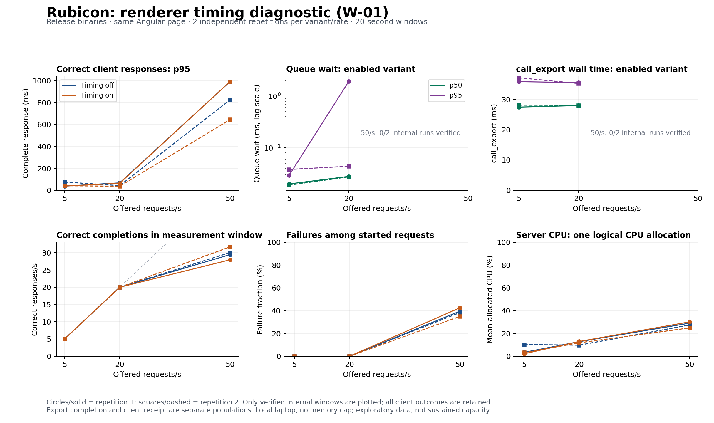

# Experiment 007: Renderer Timing and Instrumentation Cost

**Status:** Completed 12-case exploratory sequence; two internal coverage limitations retained
**Created:** 2026-10-11
**Last updated:** 2026-10-11
**Type:** Exploratory local W-01 release diagnostic
**Application implementation:** `68bcbb8`
**Replacement source/harness revision:** `b7046a8`
**Continuation revision:** `fb7c762`; only remaining original cases executed
**Measurement sessions:** 2026-10-11; exact UTC start/end times retained in both manifests
**Evidence:** [manifest](../../benchmarks/results/2026-10-11-w01-diagnostics-002/manifest.json), [interrupted manifest](../../benchmarks/results/2026-10-11-w01-diagnostics-002/interrupted-manifest.json), [client results](../../benchmarks/results/2026-10-11-w01-diagnostics-002/results.csv), [internal summaries and paired differences](../../benchmarks/results/2026-10-11-w01-diagnostics-002/diagnostics-results.json), [verification](../../benchmarks/results/2026-10-11-w01-diagnostics-002/verification.json)
**Frozen plan:** [configuration](../../benchmarks/diagnostics/config.json)
**Retained interrupted attempt:** [first-attempt record](../../benchmarks/results/2026-10-11-w01-diagnostics-001/README.md)

## Questions

How much worker wall time is spent waiting in the queue versus executing call_export? Does the bounded timing collector visibly change client results under the same workload and allocation? Which intervals still require finer measurements?

This follows [pilot 006](006-ssr-performance-pilot.md), which observed approximately 31–32 correct responses/s during overload despite low mean CPU. It evaluates the current implementation, not a general Rust or runtime-language speed claim.

## Design and Boundaries

Both executables use the same Rust application revision, dependencies, persistent single worker, 16 waiting slots, and unchanged production Angular 22.2.2 artifacts. The off binary disables render-timing; the on binary enables it. Both include the author's basic graceful HTTP shutdown. The original pilot binary was preserved before rebuilding. Release build and copied artifact hashes are recorded in the manifest/preflight.

The fixed plan offers 5, 20, and 50 requests/s for twenty seconds each, with two independent runs per variant/rate. Every run starts a fresh process, passes HTTP gates, warms at 20/s for ten seconds, and settles for two seconds. Rate order reverses in repetition two and variant order alternates. k6 2.3.0 uses the same correctness-checked client as the pilot: Home HTML, keep-alive, identity encoding, no redirects/TLS, 128 measurement VUs, two-second timeout, and three-second drain. No HTML cache is configured.

The complete server process, including its logger thread, is pinned to logical CPU 0. The generator uses logical CPUs 2 and 4 and GOMAXPROCS=2. Resource data is sampled every 500 ms. There is no memory cap, identified physical-core separation, controlled frequency/thermal state, or excluded background activity. The console helper/controller are outside server accounting. These are short exploratory windows, not sustained-capacity tests.

queue_us spans job creation to worker processing start. call_export_us spans namespace/argument preparation, JavaScript invocation, Promise/event-loop waits, adapter body buffering, and owned Rust conversion. Neither is CPU time. The event's ok field refers to the export result, not HTTP 200 or application content correctness.

Internal distributions select export-completion timestamps inside the client's declared measurement window. Client latency uses the full correct-request cohort, including its drain tail. Client completions and export completions are different populations without a per-request join. Their separate percentiles must not be added or subtracted as an exact latency breakdown.

## Correctness and Data Collection

The unchanged production application's prior browser interaction/hydration evidence is reused, with exact artifact hashes checked. Each run verifies Home, About, a query URL, HEAD, a missing-route 404, and post-load Home/About recovery. Load responses require the expected HTML headings, SSR/hydration annotations, and initial counter zero. This does not establish personalized-data isolation or arbitrary-application compatibility.

The [harness preflight](../../benchmarks/diagnostics/preflight.json) passed two smoke pairs and actual Windows Ctrl+C shutdown in a private hidden console. Membership checks allow a signal only when that console contains exactly the helper and its owned server. Normal exit, zero dropped lines, unique event IDs, and whole-session processed-event coverage are required for internal analysis. Expected events include control responses, warm-up responses, measured correct responses including the tail, and recovery; host admission 503 responses emit no export event.

The blocked-sink probe reconciled 65 emitted events as 3 retained and 62 dropped with a two-entry lossy queue. Four altered-log fixtures were rejected. Additional checks confirmed that a disabled-variant transport failure remains a measurable external failure, while a timeout in the enabled variant prevents exact event reconciliation. Compact smoke client/timing replay was byte-identical. Formatting/enqueueing overhead remains in the renderer; the writer moves sink I/O to another thread.

The first attempt at revision 55e292d stopped after eight of twelve planned runs. off-r2-50rps had one client timeout, and the analyzer incorrectly applied an instrumented-only outcome restriction to that disabled variant. All eight client summaries retain their original measurements, including that timeout. The four enabled runs had complete timing coverage and zero losses. The failed manifest and original false invalidation remain preserved; no remaining runs were filled into that attempt. After correcting and testing only the analysis restriction, the complete unchanged plan was restarted from clean revision b7046a8. No binary, application, client script, or offered-load parameter changed.

The replacement stopped after six runs when the enabled 50/s case produced five client timeouts. It recorded 785 events against 783 events explained by correct responses/control requests, with a final zero-loss counter. This is consistent with some additional work completing after client failure, but there is no per-request join to prove exact coverage. Its internal summary remains invalid and all five timeouts remain in client metrics. An earlier progress update and commit description incorrectly inferred two timeouts from the two additional events; the unchanged client summary and k6 warnings record five. A continuation distinguishes preserved internal limitations from analysis-process errors, retains the first six cases, and executes only the remaining six original cases. It records both revisions and verifies unchanged binaries, workload/configuration, application artifacts, and original plan order.

## Results

All twelve original cases are now recorded. Existing first-session runs were not repeated during continuation: all 42 existing per-run artifact hashes stayed unchanged. Every client summary has valid accounting, no unfinished requests or dropped arrivals, successful recovery, and generator headroom. All servers exited normally. Completion of the sequence does not mean passing its performance or internal coverage criteria.

Ranges are minima/maxima of the two independent run values, not confidence intervals. Correct throughput counts completions inside the measurement window; client percentiles use the complete correct-response cohort and Type-7 interpolation. No run percentiles are averaged or pooled.

Client duration is k6 sending + waiting + receiving, excluding initial connection establishment. Connection/blocking samples are preserved separately in the compact client data; this figure does not add them to the response duration.

| Timing | Offered /s | Correct /s | Correct client p95 ms | HTTP 503 per run | Transport timeouts per run | Limits passed / 2 |
| --- | ---: | ---: | ---: | ---: | ---: | ---: |
| Off | 5 | 5.00 | 38.1–75.3 | 0 | 0 | 2 |
| On | 5 | 5.00 | 38.3–41.4 | 0 | 0 | 2 |
| Off | 20 | 20.00 | 42.7–67.8 | 0 | 0 | 2 |
| On | 20 | 20.00 | 37.0–64.1 | 0 | 0 | 2 |
| Off | 50 | 29.45–30.05 | 825.0–991.8 | 381–394 | 1–2 | 0 |
| On | 50 | 27.95–31.70 | 644.5–992.4 | 348–420 | 1–5 | 0 |

Across the measured cohorts, 6,008 requests started and completed: 4,456 correct, 1,543 HTTP 503, and 9 transport timeouts. The nominal schedule was 6,000 requests; the eight-request excess consists of tolerated per-run boundary residuals. All eight 5/s and 20/s runs passed the exploratory limits; all four 50/s runs failed. The largest tested passing rate is 20/s, not an exact or sustained maximum.

The six enabled runs reported final zero-loss counters and retained 3,477 whole-session timing records. Four enabled runs at 5/s and 20/s have exact processed-event coverage; both enabled 50/s runs remain unsupported for a complete internal distribution. The second 50/s run has matching event counts but one client timeout, so the absence of a per-request join still prevents exact reconciliation. Both internal summaries retain valid=false and their reasons. All their client failures remain visible.

| Verified internal windows | Queue p50 ms | Queue p95 ms | call_export p50 ms | call_export p95 ms |
| --- | ---: | ---: | ---: | ---: |
| On, 5/s, two runs | 0.019–0.020 | 0.029–0.038 | 27.5–28.2 | 35.9–37.2 |
| On, 20/s, two runs | 0.0275–0.0280 | 0.044–1.926 | 28.0–28.1 | 35.3–35.6 |

The retained first attempt provides two separately labeled, coverage-verified enabled 50/s observations: queue p50 485.0–485.2 ms, queue p95 553.6–666.2 ms, and mean call_export 31.2–31.9 ms. These support a serialized-worker queueing hypothesis, but do not repair coverage in the replacement dataset or form a completed first-attempt paired comparison. Its partial dataset and the replacement remain separate.

At overloaded 50/s, replacement server mean CPU was 24.9–30.1% of its one-logical-CPU allocation, while correct throughput was 28–32/s. A single active export with roughly 31 ms observed service wall time in the verified earlier overload runs is consistent with approximately 32 exports/s before other costs. This is a conditional interpretation, not proof of pure CPU work, Angular cost, or a language limitation. Scheduling waits, timers/event-loop behavior, runtime integration, and HTTP delivery require finer measurement.

Instrumented-minus-disabled correct-throughput differences at 50/s were −1.50/s and +1.65/s. The sign reverses; CPU and client latency also vary substantially between runs/sessions. This small uncontrolled experiment does not establish a precise logging overhead or an instrumentation speedup. At 5/s and 20/s both variants deliver the offered correct work, which also does not imply zero overhead.

All 60 client/timing/resource/raw-log hashes were checked, and all 24 summaries replayed byte for byte from compact inputs, including the two preserved limitation results. A changed-input continuation fixture was refused before server launch. Raw logs/streams and executable binaries remain local and ignored; compact data and validation evidence are versioned.

The figure shows every client run separately. Internal panels omit unsupported 50/s populations and explicitly show 0/2 verified runs there. Those source records and errors remain retained; missing points must not be interpreted as zero queue time.

## Next Investigation

Separate preparation, JavaScript/Promise settlement, adapter response.text(), Rust conversion, and HTTP handling with explicit interval boundaries. Include measurements before enqueueing and after the export returns because the coarse worker intervals do not cover the complete client response. Pair wall time with thread CPU evidence before attributing waits to Angular, Windows scheduling, or Deno integration. Changing worker count or runtime would be a separate controlled experiment.

A transport configuration difference also deserves a separate controlled check: the current Rust host does not explicitly set TCP_NODELAY, and the inspected axum 0.8.9 plain TcpListener implementation forwards accepted streams without setting it. The installed Node v24.19.0 HTTP server source defaults noDelay to true, consistent with the [official Node option](https://nodejs.org/docs/latest-v24.x/api/http.html#httpcreateserveroptions-requestlistener). [Axum's ListenerExt](https://docs.rs/axum/0.8.9/axum/serve/trait.ListenerExt.html) documents how to configure accepted streams. Query the effective Rust socket setting and test it separately before attributing any client latency to this difference; this experiment did not change or measure that option.
