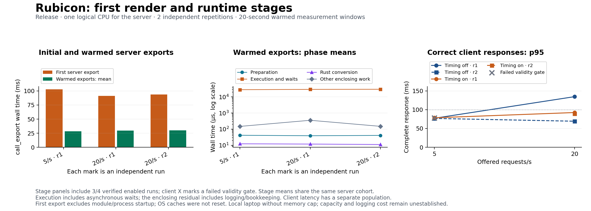

# 008 — First Render and Runtime Stage Diagnostic

**Status:** Eight release cases completed; one failed warm-up and one latency-limit failure retained
**Created:** 2026-10-11
**Last updated:** 2026-10-11
**Workload:** W-01, unchanged production Angular Home SSR
**Application source:** fc3f69c
**Collection source:** 38b22f7, clean checkout
**Results:** [2026-10-11-w01-runtime-stages-001](../../benchmarks/results/2026-10-11-w01-runtime-stages-001/README.md)
**Previous experiment:** [007](007-renderer-timing-diagnostic.md)

## Question and Method

Determine where call_export wall time lies at the tested passing-load candidates, and separate the initial render from warmed exports. The author has implemented prepare, execute, and convert timing events. Execution includes JavaScript/Angular handling, asynchronous waits, and adapter body buffering. The three phases alone do not distinguish computation from waiting or identify a particular Angular function.

[The frozen plan](../../benchmarks/diagnostics/stages-config.json) contains eight fresh-process cases: feature off/on, 5 and 20 requests/s, two independent repetitions. Rate and variant order alternate as in experiment 007. Warm-up is 10 seconds at 20/s, settle is two seconds, and measurement is 20 seconds. The server uses affinity mask 1; k6 uses mask 20 with GOMAXPROCS=2. Measurement has 128 preallocated/capped VUs; the unchanged workload script caps warm-up at 16 VUs. The two-second request timeout, three-second measurement drain allowance, half-second resource sampling, and exploratory correctness/latency limits are unchanged. No overload case or new capacity estimate is included.

The same production Angular artifacts are reused and hashed. Both Rust binaries use the same author source and locked dependency graph. The instrumented variant now emits four records per successful export; instrumentation cost must be assessed anew. Build/source hashes are checked before launch and recorded with the protocol. CPU allocation is one logical CPU, not proof of physical-core separation. Memory is observed without a cap; thermal/power state and background activity remain uncontrolled.

## First Render and Shared Cohorts

Wait for the ready banner before sending the first HTTP request. Correctness-check that initial Home response and retain its .NET client wall time. In the enabled case, initial server ID 1 and its stages must be the only export inside that control interval. This is an ordered-control association rather than a response-header client/server join. It excludes process/module startup; client-control time includes connection and decoding and varies with controller initialization. Each server process is fresh, but OS/filesystem caches were not reset. This is an initial process render, not a machine/cache cold-start benchmark.

For warmed requests, join all reached stages to their enclosing export by request ID, then select one export-completion window. Preparation, execution, conversion, their sum, and residual distributions share the same server cohort. k6 latency uses a separate correct-response cohort including its tail; do not add or subtract separate percentiles as an exact breakdown.

## Validation and Retention

The [stage preflight](../../benchmarks/diagnostics/stage-preflight.json) verifies real HTTP gates, expected stage coverage, normal private-console Ctrl+C shutdown, zero reported writer losses, and compact replay. Altered logs test missing, duplicated, reversed, unknown, wrongly associated, or late stages, incorrect outcomes, compact corruption, and undeclared schema. Original coarse analysis remains unchanged, preserving earlier data semantics. Details and replay commands are in the [stage guide](../../benchmarks/diagnostics/stages-README.md).

All planned observations remain visible, including failed limits or unsupported coverage. Stage summary validity inherits the coarse diagnostic and client requirements. Zero writer losses alone does not establish exact populations. Collection started after committing the harness and protocol. Compact samples, resource traces, metadata, and summaries are versioned; raw streams and binaries remain local.

## Results

Collection ran from 13:26:11 to 13:30:54 UTC on 2026-10-11. The original eight-case order finished without retries or replacements. All 2,005 measured requests completed with correct Home content; no measured request failed or arrival was dropped. Seven cases meet the validity requirements, and six pass the exploratory limits. A valid case can fail a latency limit; an invalid case cannot establish a passing result even when its measured responses are correct.

| Feature | Repetition | Offered/s | Correct measured cohort | Correct completions/s in window | Client p95, ms | Validity and limits |
| --- | ---: | ---: | ---: | ---: | ---: | --- |
| off | 1 | 5 | 101 | 5 | 77.12 | Valid; pass |
| on | 1 | 5 | 101 | 5 | 78.43 | Valid; pass |
| on | 1 | 20 | 401 | 20 | 92.44 | Valid; pass |
| off | 1 | 20 | 401 | 20 | 134.75 | Valid; p95 exceeds 100 ms |
| on | 2 | 20 | 400 | 20 | 89.18 | Valid; pass |
| off | 2 | 20 | 400 | 20 | 69.31 | Valid; pass |
| off | 2 | 5 | 100 | 5 | 76.77 | Valid; pass |
| on | 2 | 5 | 101 | 5 | 78.06 | Invalid warm-up; excluded from conclusions |

The measured cohort includes requests completing during the short drain tail. Completion throughput counts only the fixed 20-second window. Boundary scheduling accounts for the occasional extra started request; the two populations are deliberately reported separately. Percentiles use the existing type-7 interpolation.

### Retained Warm-up Failure

on-r2-5rps began with 179 warm-up requests: 178 correct responses and one transport timeout, plus 22 dropped arrivals. k6 stderr reports that its warm-up scenario reached the 16-VU cap and a request timed out. Subsequent measurement completed 101 correct requests, and recovery passed. This later success does not repair the failed warm-up prerequisite.

All 286 observed exports have structurally complete stage sequences, with 858 recorded stage events and a zero final writer-loss counter. The numeric expected/observed coarse counts also happen to equal 286. The timeout prevents establishing the exact processed-request population, so both coarse and stage summaries retain valid=false even though stage_join_valid=true. Do not treat this case as a fourth verified internal distribution. Warm-up resource/timing traces remain available locally; they do not isolate the cause of the transient stall.

### Verified Initial and Warmed Server Exports

Only the three enabled cases with verified client/coarse/stage populations support these comparisons. Each first-export value is a single observation. Each warmed row is a separate run, not an independent sample for every request.

| Enabled case | First export, ms | Warmed window exports | Warmed export mean, ms | Warmed export p50, ms | Warmed export p95, ms | Queue p95, ms |
| --- | ---: | ---: | ---: | ---: | ---: | ---: |
| on-r1-5rps | 102.736 | 100 | 28.326 | 28.266 | 35.792 | 0.035 |
| on-r1-20rps | 91.287 | 400 | 29.799 | 28.870 | 48.567 | 19.950 |
| on-r2-20rps | 93.735 | 400 | 30.027 | 29.084 | 48.514 | 17.341 |

Initial exports take approximately 3.1–3.6 times their own run's warmed mean. This observation supports separating the initial render from warmed measurements. It does not identify startup/JIT/setup cost or justify a snapshot optimization. Process/module initialization happened before the first request and is not included.

The phase means below share the same 100/400/400 server export-completion cohorts. The execution share is the ratio of the execution mean to the enclosing export mean, not a mean of individual shares.

| Enabled case | Prepare mean, µs | Execute/wait mean, ms | Convert mean, µs | Other enclosing mean, µs | Execute share |
| --- | ---: | ---: | ---: | ---: | ---: |
| on-r1-5rps | 41.730 | 28.124 | 12.320 | 148.230 | 99.29% |
| on-r1-20rps | 38.973 | 29.393 | 11.865 | 354.913 | 98.64% |
| on-r2-20rps | 40.860 | 29.826 | 11.158 | 149.203 | 99.33% |

Execution and asynchronous waits dominate measured call_export wall time. The Rust preparation/conversion boundaries are small in these observations. This supports investigating inside the JavaScript adapter and outer HTTP path before attempting to optimize those conversions. It does not establish that Angular computation consumes 99% of CPU. Body buffering, event-loop/timer waits, scheduling, and framework work remain combined in execute.

Queue tails also become visible at 20/s, despite correct responses. The server remains a single worker. Client p95 and server phase/queue p95 use different cohorts and cannot be subtracted or added as an exact request breakdown.

### Instrumentation Cost and Limits

At 20/s, enabled client p95 is 42.32 ms lower than disabled in repetition 1, but 19.87 ms higher in repetition 2. The disabled p95 itself changes from 134.75 to 69.31 ms. At 5/s, only one enabled repetition meets the validity prerequisite. This experiment cannot establish a stable logging speedup or a precise latency penalty.

Measured server process CPU at 20/s is 17.12/17.19% of its allocated logical CPU with timing enabled, compared with 11.82/11.75% disabled. Those observed differences are retained, but short serial runs on an uncontrolled laptop do not isolate a pure instrumentation cost. CPU here covers the whole server process and logger; it is not isolate-thread CPU attribution. Generator mean CPU stays below 2.32% of its two allocated logical CPUs during measurement. This measured headroom does not remove the failed warm-up's VU-cap limitation.

The 100 ms exploratory p95 limit is not met by every valid 20/s case. Neither 20/s as a sustained guarantee nor maximum throughput is established. The earlier overload experiment remains separate. Network/HTTP policy, including the unresolved TCP_NODELAY consideration in experiment 007, remains unchanged; this stage experiment does not test it.

The figure includes only three verified internal populations. The invalid client's measured p95 remains visible as a gray X. Legends sit outside the data, and independent repetitions remain separate. The plotting change made after collection only clarifies validity and layout; it does not alter measured inputs or analysis rules. The collection manifest retains the original plot source hash at 38b22f7; verification.json records the source used for the final PNG/SVG separately.

## Verification and Next Investigation

[verification.json](../../benchmarks/results/2026-10-11-w01-runtime-stages-001/verification.json) records 127 artifact hash checks and 24 byte-identical compact summary replays across all eight cases, including the invalid case. All eight servers stopped normally through their verified private consoles; none required forced termination. All four enabled sessions reported zero writer losses. Exactly 4,578 stage records cover 1,526 exports across the three verified enabled sessions. A further 858 records from 286 observed exports remain retained under the invalid case. Previous coarse datasets are unchanged.

Compact replay preserves both valid and invalid classifications. Full raw streams remain ignored and local; their recorded hashes support local audit, while compact files support repository replay. The preceding smoke observations remain collection checks and are not combined with these measurements. Framework/application source was unchanged during this benchmark step.

The next author implementation should distinguish Angular handler completion from response.text() buffering and record outer HTTP work, with explicit request correlation and a feature-off baseline. Add thread CPU evidence before attributing execute wall time to computation. Investigate warm-up stalls and generator provisioning in a separately declared protocol, preserving this failed observation. No runtime replacement, worker pool, snapshot, or serializer performance claim follows from the current data alone.
