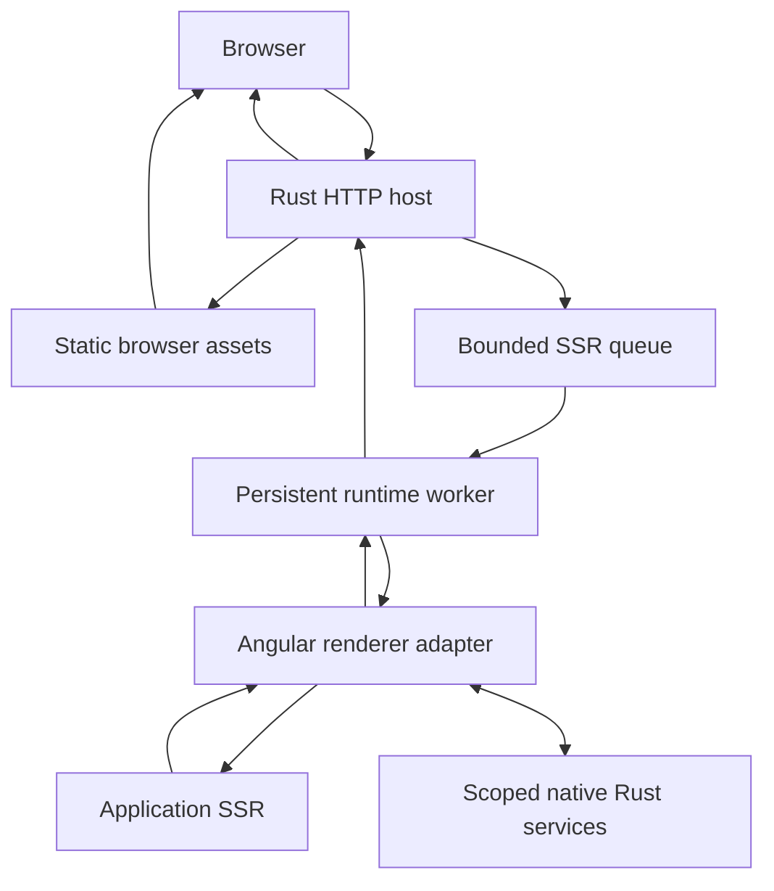

# Rubicon Architecture

**Status:** Draft
**Created:** 2026-10-09
**Last updated:** 2026-10-10
**Implementation:** HTTP-to-JavaScript worker prototype; Angular SSR not implemented

## Purpose and Context

This specification describes the proposed components, build artifacts, and request lifecycle of Rubicon. The architecture must support a reusable hosting product and a separate consuming Angular application.

The initial runtime candidate is deno_core, subject to compatibility validation. Angular rendering remains JavaScript execution within the host process. Rust manages HTTP, scheduling, and native services.

## Scope

This draft covers startup, artifact loading, request dispatch, rendering workers, native service access, cleanup, and shutdown. It also identifies the responsibilities of the TypeScript integration and server executable.

The Angular compiler and existing build tools remain responsible for compiling the application. Rubicon's initial tooling may coordinate those tools and package their outputs. Custom Angular builders, installation schematics, HTML caching, and snapshots are later extensions.

## Requirements

| ID | Requirement | Acceptance evidence |
| --- | --- | --- |
| ARCH-01 | The Rust library must be reusable without application-specific components or routes. | The example consumes documented public entrypoints. |
| ARCH-02 | The host must validate configuration and initialize its declared rendering capacity before advertising full readiness. | Startup checks and readiness observations. |
| ARCH-03 | The runtime adapter must own engine-specific loading, operation registration, and event-loop behavior. | Boundary review and renderer integration. |
| ARCH-04 | The scheduler must enforce configured worker and queue limits. | Capacity, rejection, and queue instrumentation checks. |
| ARCH-05 | Runtime reuse must preserve request isolation and per-request cleanup. | Sequential and concurrent identity checks. |
| ARCH-06 | Native services must be accessed through scoped operations with explicit results and failures. | Async service integration and failure checks. |
| ARCH-07 | The host must preserve renderer response semantics through HTTP delivery. | Contract verification. |
| ARCH-08 | Shutdown and failed-render recovery must have bounded, observable behavior. | Cancellation, failure, and shutdown checks. |

## Design and Request Flow

### Implemented Worker Prototype

The current executable initializes the V8 platform on the main thread and starts one rendering worker through the library's public `Renderer`. The worker creates a current-thread Tokio executor and a `JavaScriptRuntime` on its dedicated thread, then loads and evaluates `js/render.mjs` once. Runtime operations remain on that thread.

Startup waits for a one-shot module-initialization result before binding the HTTP listener. This confirms runtime creation and module evaluation; the `render` export is checked when invoked, so this handshake does not establish full application rendering readiness.

Axum stores a cloneable `Renderer` in application state. A `GET /` handler submits a job through a bounded Tokio `mpsc` channel and waits for that job's `oneshot` reply. The worker calls the module's zero-argument `render` export, converts the result to a Rust string, and returns it to the handler as buffered HTML.

The queue capacity is hardcoded to 16 waiting jobs, and the worker executes one job at a time. Submission uses `try_send`, so a full queue is rejected immediately rather than creating additional tasks waiting to enqueue. This bounds queued render jobs, not all HTTP connections or total process memory. The value is provisional and has not been tuned by benchmarks.

| Current outcome | HTTP behavior |
| --- | --- |
| String returned by `render` | 200 with HTML content type and the returned body. |
| Queue full | 503 with a generic busy response. |
| Worker channel or reply channel closed | 503 with a generic unavailable response. |
| Export execution or result conversion fails | 500 with a generic failure response; details are logged server-side. |

The demonstration module maintains a render counter to show engine and module persistence. The job does not yet carry request information, and retaining this diagnostic counter does not verify isolation of user data. The following Angular request flow remains a proposal.

### Proposed Components

| Component | Responsibility |
| --- | --- |
| Rust library | Configuration, HTTP integration, scheduling, response delivery, and service interfaces. |
| Server executable | Read configuration, construct the host, start serving, and initiate shutdown. |
| Runtime adapter | Initialize JavaScript workers, resolve modules, register native operations, and drive asynchronous execution. |
| Angular/TypeScript adapter | Map Rubicon requests to Angular rendering and map Angular outcomes back to the contract. |
| Application | Define components, routes, providers, and business rules. |
| Example application | Exercise the public integration and provide controlled correctness fixtures. |
| Benchmark harness | Generate traffic and preserve correctness, latency, and resource evidence. |

The first Rust package may contain both a library target and an executable target. Additional crates should be introduced when an actual boundary or independent dependency justifies them.

### Proposed Build Flow

The Angular toolchain compiles the browser application and server code. The integration must identify the server entrypoint, include the renderer adapter, and supply required assets or manifests. The exact artifact layout is TBD and must be discovered against a pinned Angular version.

The initial pipeline must not require the Rust host to transpile TypeScript or compile Angular templates at request time. Node may remain a build dependency even when the production host uses an embedded runtime.

### Proposed Request Flow

The following diagram describes a proposal, not an implemented system.



1. The host validates the request and constructs its effective URL using an explicit proxy policy.
2. Host-owned endpoints and browser assets are dispatched by the Rust router.
3. An application-rendering request receives an identifier, deadline, and isolated context.
4. The scheduler either admits it, queues it within capacity, or rejects it.
5. A worker invokes the renderer and drives the asynchronous work required to complete it.
6. The adapter invokes Angular for the application route and normalizes the outcome.
7. The host validates response metadata, applies transport rules, and sends the response.
8. Request resources are released before the worker becomes available again.

Angular remains responsible for matching application routes during rendering. The host's endpoint routing must have a documented precedence so API and asset paths are not accidentally treated as application pages.

## Contracts and Data

| Boundary | Input | Output | Failure behavior |
| --- | --- | --- | --- |
| Configuration to host | Artifact paths, worker settings, limits, and service configuration | Initialized host | Invalid configuration prevents readiness. |
| Scheduler to worker | Request context and cancellation/deadline state | Contract outcome | Expired or cancelled work is removed or stopped. |
| Worker to Angular adapter | Serializable request information and scoped service access | Response, no matching route, or failure | The worker reports the failure and cleans up. |
| Adapter to native service | Request-scoped operation and arguments | Data or explicit error | Late results cannot affect a different request. |

The [rendering contract](rendering-contract.md) owns field definitions, response outcomes, and failure semantics. Configuration format, module export names, and service-operation names remain TBD; they must be documented once the prototype establishes a working integration.

The initial response is buffered HTML. The matching browser artifacts must come from the same application build. Any HTML processing must preserve the structure and state required for hydration.

## Lifecycle, Concurrency, and Isolation

### Process and Worker State

Process-wide state includes immutable configuration, service pools, and scheduling infrastructure. Worker-wide state includes the JavaScript runtime, loaded modules, and reusable renderer metadata. Request-local state includes input, Angular application resources, document state, service-operation tracking, and pending response data.

deno_core's JsRuntime is not Send or Sync. The initial implementation should create each runtime on its owning thread and keep runtime operations there, communicating with the scheduler through messages. V8 platform initialization must follow the selected version's requirements. These are integration constraints, not evidence of higher throughput.

### Initialization and Reuse

Each worker initializes its environment, loads the application entrypoint, and completes a readiness check. Reuse retains engine and module initialization while request cleanup disposes of request-specific resources.

A persistent Angular engine or cached bootstrap function must not retain a previous request's user data. Application-level global state and providers require an explicit ownership review.

### Scheduling and Shutdown

The current prototype permits one active render on its single worker and has a fixed queue capacity of 16 waiting jobs. This conservative policy must be evaluated on both CPU-heavy and asynchronous workloads. The proposed host should make pool size, queue capacity, and render deadlines configurable; the configuration interface and evaluated defaults remain TBD.

Shutdown stops admission, allows active requests to finish within a grace period, cancels remaining work, and releases worker and service resources. The implementation must identify which steps can be interrupted and how an unusable runtime is replaced.

## Failure and Resource Limits

Queue-full, missing-route, application-failure, and runtime-failure outcomes must be recorded separately. A failed render must not silently return incomplete HTML as a successful response.

Dropping an asynchronous wait is not sufficient evidence that JavaScript execution or native work has stopped. The runtime adapter must implement and verify actual cancellation or interruption behavior. A worker with uncertain cleanup must not be reused.

The required configurable limits include queue capacity, active worker count, render deadline, and maximum buffered response size. Request-input and native-operation limits must also be defined before load testing. Startup failures and worker replacement must remain observable.

## Performance Expectations

**Not measured.**

The architecture permits experiments on pool size, scheduling, native data access, and startup initialization. Each additional worker consumes memory, and each Rust-JavaScript boundary may incur copying, conversion, or serialization costs.

The minimal candidate should already reuse initialized workers. A conventional Node baseline also uses a persistent server; an artificial per-request engine startup is not an adequate reference for steady-state SSR.

Snapshots are a later startup experiment. HTML caching is a separate serving scenario because it bypasses dynamic rendering.

## Verification

| Requirement | Verification method | Planned evidence | State |
| --- | --- | --- | --- |
| ARCH-01, ARCH-03 | Inspect component boundaries and run the consuming example. | Library and adapter integration review. | Planned |
| ARCH-02 | Exercise missing artifacts, invalid configuration, and startup readiness. | Startup checks. | Planned |
| ARCH-04 | Offer work above capacity and inspect admission and queue counts. | Scheduler checks and overload run. | Partial: controlled queue rejection verified; configured scheduling and HTTP overload planned. |
| ARCH-05 | Alternate identities and verify cleanup after successful and failed renders. | Isolation checks and sustained-operation run. | Planned |
| ARCH-06 | Exercise service success, failure, and late completion. | Native-service integration checks. | Planned |
| ARCH-07 | Verify HTTP delivery against the rendering contract. | Contract checks. | Planned |
| ARCH-08 | Disconnect clients, expire deadlines, and initiate shutdown. | Cancellation and recovery checks. | Partial: continued execution after ordinary renderer errors verified; cancellation and shutdown planned. |

### Initial HTTP Host Verification

On 2026-10-10, the author added Axum 0.8.9 and enabled Tokio's multi-thread runtime and network features. At this milestone, the executable bound to `127.0.0.1:3000`, routed `GET /` to a handler returning `Html`, and served requests through `axum::serve`. The response body was the fixed Rust string `<h1>Rubicon</h1>`; this initial handler did not invoke the JavaScript renderer.

The following checks completed successfully:

```text
cargo fmt --manifest-path crates/rubicon/Cargo.toml -- --check
cargo check --locked --offline --manifest-path crates/rubicon/Cargo.toml
cargo test --locked --offline --manifest-path crates/rubicon/Cargo.toml --lib
cargo build --locked --offline --manifest-path crates/rubicon/Cargo.toml
curl.exe --max-time 5 -sS -i http://127.0.0.1:3000/
```

The HTTP check used the author's already-running server and observed `200 OK`, `Content-Type: text/html; charset=utf-8`, and the exact body `<h1>Rubicon</h1>`. The existing runtime regression test passed, with one test passed and zero failed. Linker warning LNK4098 persists in the library test executable; no linker warning was emitted by the application build during this validation.

These checks established the initial HTTP scaffold. The next milestone below connected it to the JavaScript worker; the complete architecture requirements remain open.

### Persistent Worker HTTP Verification

Later on 2026-10-10, the author added `src/renderer.rs`, enabled Tokio's `sync` feature, and connected the Axum handler to the worker described above. Review confirmed that runtime creation, module loading, and export calls occur on the same dedicated thread, with module loading outside the job loop.

The four Cargo commands listed in the preceding milestone were rerun successfully against this implementation: formatting check, locked offline compilation check, library tests, and executable build. The existing synchronous runtime regression test passed, with one test passed and zero failed. It does not exercise worker queue behavior. Linker warning LNK4098 was emitted for both the library test executable and the application build.

Two successive requests were sent to the author's already-running local server:

```text
curl.exe --max-time 5 -sS -i http://127.0.0.1:3000/ http://127.0.0.1:3000/
```

Both returned `200 OK` and `Content-Type: text/html; charset=utf-8`. The bodies were `<h1>Rubicon</h1><p>Render 3</p>` and `<h1>Rubicon</h1><p>Render 4</p>`. The increasing counter confirms that HTTP requests invoke the persistent module instead of returning a fixed Rust string. These were correctness checks, not performance measurements.

Queue overload, worker-channel closure, startup failure, and HTTP error paths have not been exercised by these repository HTTP checks. The prototype's readiness handshake is limited to module initialization. The worker thread handle is detached; there is no implemented join or graceful shutdown policy, render deadline, runtime replacement, or interruption of active JavaScript. A queued job whose reply receiver has closed is skipped, but this does not cancel an active render.

Full acceptance of ARCH-02, ARCH-04, ARCH-05, ARCH-07, and ARCH-08 still requires configuration, failure, isolation, complete response-contract, and lifecycle verification. Angular SSR and benchmark results remain unimplemented.

### Queue Rejection and Renderer Error Verification

On 2026-10-10, the author added a queue unit test to `src/renderer.rs` and a separate [worker integration target](../../crates/rubicon/tests/renderer_errors.rs), supported by a controlled [JavaScript fixture](../../crates/rubicon/tests/fixtures/renderer_errors.mjs). Tokio's `time` feature is now explicit. The integration target uses `harness = false` and its own current-thread Tokio `main`, initializing the V8 platform before starting the worker.

The queue test fills all 16 slots while retaining the receiver without consuming jobs. Calling `Renderer::render` must return `RenderError::Busy` within the test's two-second wait limit, and the queue must still contain exactly 16 jobs. This verifies the library admission behavior under controlled full-queue conditions; it is not an HTTP overload or latency measurement.

The integration check initializes one `Renderer` and invokes it five times. Calls 1, 3, and 5 return `<p>Render 1</p>`, `<p>Render 3</p>`, and `<p>Render 5</p>`. Call 2 throws an intentional JavaScript exception, and call 4 returns an object that cannot be converted to a Rust string. Both failures must arrive as `RenderError::Failed` with the expected error category. The subsequent valid results verify continued execution and retained module state after each ordinary failure.

The following checks completed successfully:

```text
cargo fmt --manifest-path crates/rubicon/Cargo.toml -- --check
cargo check --locked --offline --manifest-path crates/rubicon/Cargo.toml --all-targets
cargo test --locked --offline --manifest-path crates/rubicon/Cargo.toml
```

The library reported two tests passed and zero failed. The standalone integration executable completed with `Renderer error checks passed.`; the binary and documentation test harnesses contained zero tests. Linker warning LNK4098 persists in the test and application targets.

The five-second integration limits apply to startup and individual asynchronous render waits. They do not implement cancellation of active JavaScript, recovery after engine termination or resource exhaustion, or a bounded worker join. Dropping `Renderer` does not prove graceful shutdown. HTTP 500/503 mapping, worker-channel closure, startup-failure paths, request isolation, and load behavior remain unverified by these checks. These results do not establish performance improvements or full acceptance of ARCH-04 or ARCH-08.

## Open Questions

| Question | Impact | Next action |
| --- | --- | --- |
| Which generated Angular entrypoint and manifests are required? | Defines the artifact-loading integration. | Inspect a pinned example build. |
| Which Web or Node APIs are required by the application bundle? | Determines runtime extensions. | Run a compatibility spike and inventory dependencies. |
| How will blocking JavaScript be interrupted safely? | Determines deadline enforcement and recovery. | Prototype the selected engine's interruption mechanism. |
| Which native service calls are exposed to the adapter? | Defines scope and data ownership. | Specify one deterministic asynchronous operation. |
| What pool and queue settings meet the resource budget? | Controls latency and memory. | Pilot under the benchmark protocol. |

## Related Decisions and Sources

- [Project overview](project-overview.md).
- [Rendering contract](rendering-contract.md).
- [Benchmark protocol](benchmark-protocol.md).
- [ADR 001: JavaScript runtime selection](../adr/001-runtime-selection.md).
- [AngularAppEngine API](https://angular.dev/api/ssr/AngularAppEngine), rolling documentation checked on 2026-10-09; selected Angular version TBD.
- [deno_core JsRuntime](https://docs.rs/deno_core/latest/deno_core/struct.JsRuntime.html), documentation observed at 0.412.0 on 2026-10-09; prototype dependency pinned to 0.412.0.
- [Axum serve API](https://docs.rs/axum/latest/axum/fn.serve.html), rolling documentation observed at 0.8.9 on 2026-10-10; prototype dependency pinned to 0.8.9.
- [Tokio bounded channel submission](https://docs.rs/tokio/latest/tokio/sync/mpsc/struct.Sender.html#method.try_send), documentation observed at 1.53.2 on 2026-10-10; prototype dependency pinned to 1.53.2.
- [Angular library creation](https://angular.dev/tools/libraries/creating-libraries), rolling documentation checked on 2026-10-09.
- [Cargo workspaces](https://doc.rust-lang.org/cargo/reference/workspaces.html), rolling documentation checked on 2026-10-09.
