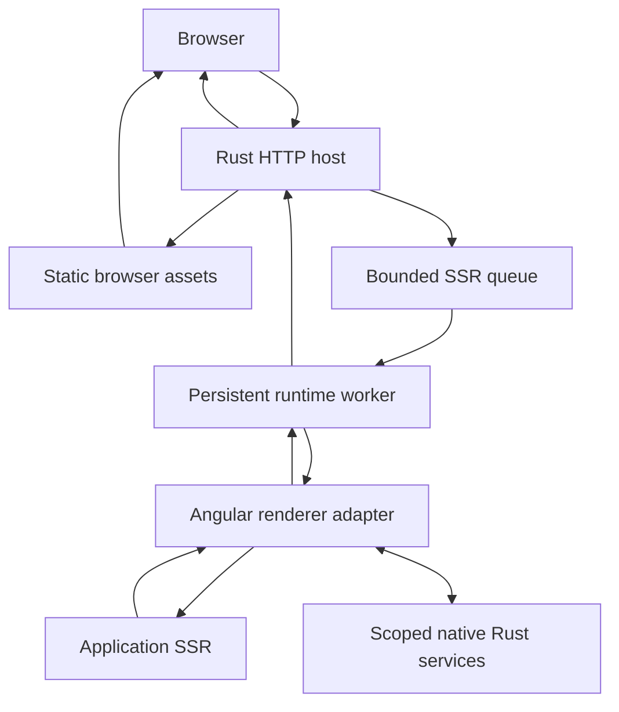

# Rubicon Architecture

**Status:** Draft
**Created:** 2026-10-09
**Last updated:** 2026-10-10
**Implementation:** HTTP-to-JavaScript worker prototype and Node.js Angular SSR/hydration reference; Angular integration into Rubicon pending

## Purpose and Context

This specification describes the proposed components, build artifacts, and request lifecycle of Rubicon. The architecture must support a reusable hosting product and a separate consuming Angular application.

The initial runtime candidate is deno_core, subject to compatibility validation. Angular rendering remains JavaScript execution within the host process. Rust manages HTTP, scheduling, and native services.

## Scope

This draft covers startup, artifact loading, request dispatch, rendering workers, native service access, cleanup, and shutdown. It also identifies the responsibilities of the TypeScript integration and server executable.

The Angular compiler and existing build tools remain responsible for compiling the application. Rubicon's initial tooling may coordinate those tools and package their outputs. Custom Angular builders, installation schematics, HTML caching, and snapshots are later extensions.

## Requirements

| ID | Requirement | Acceptance evidence |
| --- | --- | --- |
| ARCH-01 | The Rust library must be reusable without application-specific components or routes. | The example consumes documented public entrypoints. |
| ARCH-02 | The host must validate configuration and initialize its declared rendering capacity before advertising full readiness. | Startup checks and readiness observations. |
| ARCH-03 | The runtime adapter must own engine-specific loading, operation registration, and event-loop behavior. | Boundary review and renderer integration. |
| ARCH-04 | The scheduler must enforce configured worker and queue limits. | Capacity, rejection, and queue instrumentation checks. |
| ARCH-05 | Runtime reuse must preserve request isolation and per-request cleanup. | Sequential and concurrent identity checks. |
| ARCH-06 | Native services must be accessed through scoped operations with explicit results and failures. | Async service integration and failure checks. |
| ARCH-07 | The host must preserve renderer response semantics through HTTP delivery. | Contract verification. |
| ARCH-08 | Shutdown and failed-render recovery must have bounded, observable behavior. | Cancellation, failure, and shutdown checks. |

## Design and Request Flow

### Implemented Worker Prototype

The current executable initializes the V8 platform on the main thread and starts one rendering worker through the library's public `Renderer`. The worker creates a current-thread Tokio executor and a `JavaScriptRuntime` on its dedicated thread, then loads and evaluates `js/render.mjs` once. Runtime operations remain on that thread.

Startup waits for a one-shot module-initialization result before binding the HTTP listener. This confirms runtime creation and module evaluation; the `render` export is checked when invoked, so this handshake does not establish full application rendering readiness.

Axum stores a cloneable `Renderer` in application state. Handlers registered through `get` for `/` and `/{*path}` also receive HEAD requests. They extract `OriginalUri`, `Method`, and `HeaderMap`, combine the original path and query with the fixed origin `http://127.0.0.1:3000`, and construct an owned `RenderRequest` containing a string identifier, URL, method, and header pairs. A process-local atomic counter generates the identifier before header conversion; checked increment rejects exhaustion without wrapping. Client headers do not select this identifier. The host visits each name and all its values to preserve repeated fields, rejecting unsupported text values with HTTP 400 before dispatch. Each `RenderJob` carries this request and its own `oneshot` reply through the bounded Tokio `mpsc` channel. The worker borrows `job.request`, converts it directly into a V8 object through `serde_v8::to_v8`, and invokes the module's `render(request)` export. The result is deserialized into an owned `RenderResponse`, transported through the reply channel, and validated by `into_http_response` in the handler. Axum applies transport framing and omits the HEAD body.

The queue capacity is hardcoded to 16 waiting jobs, and the worker executes one job at a time. Submission uses `try_send`, so a full queue is rejected immediately rather than creating additional tasks waiting to enqueue. This bounds queued render jobs, not all HTTP connections or total process memory. The value is provisional and has not been tuned by benchmarks.

| Current outcome | HTTP behavior |
| --- | --- |
| Valid response object returned by `render` | Preserves application status, repeated header pairs, and buffered body; HEAD omits the body. The demonstration supplies 200 and HTML content type. |
| Request identifier counter exhausted | 503 before header conversion or worker submission; counter remains exhausted. |
| Queue full | 503 with a generic busy response. |
| Worker channel or reply channel closed | 503 with a generic unavailable response. |
| Export execution or result conversion fails | 500 with a generic failure response; details are logged server-side. |
| Response metadata violates host policy | 500 with a generic failure response; conversion details and request identifier are logged server-side. |

The demonstration module displays the request identifier, URL, a page method, and `x-rubicon-demo` header values using HTML text escaping and maintains a render counter to show engine and module persistence. For HEAD, the page method is `GET`, so the generated HTML describes the corresponding GET representation; the actual request method remains `HEAD`. A job currently carries identifier, URL, method, and header pairs from the proposed request model. The identifier is unique within one server execution and resets on restart; library callers supply their own identifier. Rendering-failure logs include the HTTP host's generated identifier. Retaining this diagnostic counter and returning the current fields do not verify isolation of user data or request cleanup. Empty HEAD delivery and demonstration Content-Length matching the GET representation are verified. The following Angular request flow remains a proposal.

### Proposed Components

| Component | Responsibility |
| --- | --- |
| Rust library | Configuration, HTTP integration, scheduling, response delivery, and service interfaces. |
| Server executable | Read configuration, construct the host, start serving, and initiate shutdown. |
| Runtime adapter | Initialize JavaScript workers, resolve modules, register native operations, and drive asynchronous execution. |
| Angular/TypeScript adapter | Map Rubicon requests to Angular rendering and map Angular outcomes back to the contract. |
| Application | Define components, routes, providers, and business rules. |
| Example application | Exercise the public integration and provide controlled correctness fixtures. |
| Benchmark harness | Generate traffic and preserve correctness, latency, and resource evidence. |

The first Rust package may contain both a library target and an executable target. Additional crates should be introduced when an actual boundary or independent dependency justifies them.

### Proposed Build Flow

The Angular toolchain compiles the browser application and server code. The integration must identify the server entrypoint, include the renderer adapter, and supply required assets or manifests. The exact artifact layout is TBD and must be discovered against a pinned Angular version.

The initial pipeline must not require the Rust host to transpile TypeScript or compile Angular templates at request time. Node may remain a build dependency even when the production host uses an embedded runtime.

### Proposed Request Flow

The following diagram describes a proposal, not an implemented system.



1. The host validates the request and constructs its effective URL using an explicit proxy policy.
2. Host-owned endpoints and browser assets are dispatched by the Rust router.
3. An application-rendering request receives an identifier, deadline, and isolated context.
4. The scheduler either admits it, queues it within capacity, or rejects it.
5. A worker invokes the renderer and drives the asynchronous work required to complete it.
6. The adapter invokes Angular for the application route and normalizes the outcome.
7. The host validates response metadata, applies transport rules, and sends the response.
8. Request resources are released before the worker becomes available again.

Angular remains responsible for matching application routes during rendering. The host's endpoint routing must have a documented precedence so API and asset paths are not accidentally treated as application pages.

## Contracts and Data

| Boundary | Input | Output | Failure behavior |
| --- | --- | --- | --- |
| Configuration to host | Artifact paths, worker settings, limits, and service configuration | Initialized host | Invalid configuration prevents readiness. |
| Scheduler to worker | Request context and cancellation/deadline state | Contract outcome | Expired or cancelled work is removed or stopped. |
| Worker to Angular adapter | Serializable request information and scoped service access | Response, no matching route, or failure | The worker reports the failure and cleans up. |
| Adapter to native service | Request-scoped operation and arguments | Data or explicit error | Late results cannot affect a different request. |

The [rendering contract](rendering-contract.md) owns field definitions, response outcomes, and failure semantics. The demonstration currently uses `render(request)` with string identifier, URL, method, and header-pair fields; configuration format, the complete Angular adapter interface, and service-operation names remain TBD.

The initial response is buffered HTML. The matching browser artifacts must come from the same application build. Any HTML processing must preserve the structure and state required for hydration.

## Lifecycle, Concurrency, and Isolation

### Process and Worker State

Process-wide state includes immutable configuration, service pools, and scheduling infrastructure. Worker-wide state includes the JavaScript runtime, loaded modules, and reusable renderer metadata. Request-local state includes input, Angular application resources, document state, service-operation tracking, and pending response data.

deno_core's JsRuntime is not Send or Sync. The initial implementation should create each runtime on its owning thread and keep runtime operations there, communicating with the scheduler through messages. V8 platform initialization must follow the selected version's requirements. These are integration constraints, not evidence of higher throughput.

### Initialization and Reuse

Each worker initializes its environment, loads the application entrypoint, and completes a readiness check. Reuse retains engine and module initialization while request cleanup disposes of request-specific resources.

A persistent Angular engine or cached bootstrap function must not retain a previous request's user data. Application-level global state and providers require an explicit ownership review.

### Scheduling and Shutdown

The current prototype permits one active render on its single worker and has a fixed queue capacity of 16 waiting jobs. This conservative policy must be evaluated on both CPU-heavy and asynchronous workloads. The proposed host should make pool size, queue capacity, and render deadlines configurable; the configuration interface and evaluated defaults remain TBD.

Shutdown stops admission, allows active requests to finish within a grace period, cancels remaining work, and releases worker and service resources. The implementation must identify which steps can be interrupted and how an unusable runtime is replaced.

## Failure and Resource Limits

Queue-full, missing-route, application-failure, and runtime-failure outcomes must be recorded separately. A failed render must not silently return incomplete HTML as a successful response.

Dropping an asynchronous wait is not sufficient evidence that JavaScript execution or native work has stopped. The runtime adapter must implement and verify actual cancellation or interruption behavior. A worker with uncertain cleanup must not be reused.

The required configurable limits include queue capacity, active worker count, render deadline, and maximum buffered response size. Request-input and native-operation limits must also be defined before load testing. Startup failures and worker replacement must remain observable.

## Performance Expectations

**Not measured.**

The architecture permits experiments on pool size, scheduling, native data access, and startup initialization. Each additional worker consumes memory, and each Rust-JavaScript boundary may incur copying, conversion, or serialization costs.

The minimal candidate should already reuse initialized workers. A conventional Node baseline also uses a persistent server; an artificial per-request engine startup is not an adequate reference for steady-state SSR.

Snapshots are a later startup experiment. HTML caching is a separate serving scenario because it bypasses dynamic rendering.

## Verification

| Requirement | Verification method | Planned evidence | State |
| --- | --- | --- | --- |
| ARCH-01, ARCH-03 | Inspect component boundaries and run the consuming example. | Library and adapter integration review. | Planned |
| ARCH-02 | Exercise missing artifacts, invalid configuration, and startup readiness. | Startup checks. | Planned |
| ARCH-04 | Offer work above capacity and inspect admission and queue counts. | Scheduler checks and overload run. | Partial: controlled queue rejection verified; configured scheduling and HTTP overload planned. |
| ARCH-05 | Alternate identities and verify cleanup after successful and failed renders. | Isolation checks and sustained-operation run. | Planned |
| ARCH-06 | Exercise service success, failure, and late completion. | Native-service integration checks. | Planned |
| ARCH-07 | Verify HTTP delivery against the rendering contract. | Contract checks. | Partial: structured worker results, response conversion, and temporary router delivery checks passed; live network verification of the structured path and complete Angular outcomes remain planned. |
| ARCH-08 | Disconnect clients, expire deadlines, and initiate shutdown. | Cancellation and recovery checks. | Partial: continued execution after ordinary synchronous errors, Promise rejection, and response-conversion errors verified; cancellation and shutdown planned. |

### Initial HTTP Host Verification

On 2026-10-10, the author added Axum 0.8.9 and enabled Tokio's multi-thread runtime and network features. At this milestone, the executable bound to `127.0.0.1:3000`, routed `GET /` to a handler returning `Html`, and served requests through `axum::serve`. The response body was the fixed Rust string `<h1>Rubicon</h1>`; this initial handler did not invoke the JavaScript renderer.

The following checks completed successfully:

```text
cargo fmt --manifest-path crates/rubicon/Cargo.toml -- --check
cargo check --locked --offline --manifest-path crates/rubicon/Cargo.toml
cargo test --locked --offline --manifest-path crates/rubicon/Cargo.toml --lib
cargo build --locked --offline --manifest-path crates/rubicon/Cargo.toml
curl.exe --max-time 5 -sS -i http://127.0.0.1:3000/
```

The HTTP check used the author's already-running server and observed `200 OK`, `Content-Type: text/html; charset=utf-8`, and the exact body `<h1>Rubicon</h1>`. The existing runtime regression test passed, with one test passed and zero failed. Linker warning LNK4098 persists in the library test executable; no linker warning was emitted by the application build during this validation.

These checks established the initial HTTP scaffold. The next milestone below connected it to the JavaScript worker; the complete architecture requirements remain open.

### Persistent Worker HTTP Verification

Later on 2026-10-10, the author added `src/renderer.rs`, enabled Tokio's `sync` feature, and connected the Axum handler to the worker described above. Review confirmed that runtime creation, module loading, and export calls occur on the same dedicated thread, with module loading outside the job loop.

The four Cargo commands listed in the preceding milestone were rerun successfully against this implementation: formatting check, locked offline compilation check, library tests, and executable build. The existing synchronous runtime regression test passed, with one test passed and zero failed. It does not exercise worker queue behavior. Linker warning LNK4098 was emitted for both the library test executable and the application build.

Two successive requests were sent to the author's already-running local server:

```text
curl.exe --max-time 5 -sS -i http://127.0.0.1:3000/ http://127.0.0.1:3000/
```

Both returned `200 OK` and `Content-Type: text/html; charset=utf-8`. The bodies were `<h1>Rubicon</h1><p>Render 3</p>` and `<h1>Rubicon</h1><p>Render 4</p>`. The increasing counter confirms that HTTP requests invoke the persistent module instead of returning a fixed Rust string. These were correctness checks, not performance measurements.

Queue overload, worker-channel closure, startup failure, and HTTP error paths have not been exercised by these repository HTTP checks. The prototype's readiness handshake is limited to module initialization. The worker thread handle is detached; there is no implemented join or graceful shutdown policy, render deadline, runtime replacement, or interruption of active JavaScript. A queued job whose reply receiver has closed is skipped, but this does not cancel an active render.

Full acceptance of ARCH-02, ARCH-04, ARCH-05, ARCH-07, and ARCH-08 still requires configuration, failure, isolation, complete response-contract, and lifecycle verification. Angular SSR and benchmark results remain unimplemented.

### Queue Rejection and Renderer Error Verification

On 2026-10-10, the author added a queue unit test to `src/renderer.rs` and a separate [worker integration target](../../crates/rubicon/tests/renderer_errors.rs), supported by a controlled [JavaScript fixture](../../crates/rubicon/tests/fixtures/renderer_errors.mjs). Tokio's `time` feature is now explicit. The integration target uses `harness = false` and its own current-thread Tokio `main`, initializing the V8 platform before starting the worker.

The queue test fills all 16 slots while retaining the receiver without consuming jobs. Calling `Renderer::render` must return `RenderError::Busy` within the test's two-second wait limit, and the queue must still contain exactly 16 jobs. This verifies the library admission behavior under controlled full-queue conditions; it is not an HTTP overload or latency measurement.

At this milestone, the integration check initialized one `Renderer` and invoked it five times. Calls 1, 3, and 5 returned `<p>Render 1</p>`, `<p>Render 3</p>`, and `<p>Render 5</p>`. Call 2 threw an intentional JavaScript exception, and call 4 returned an object that could not be converted to a Rust string. Both failures arrived as `RenderError::Failed` with the expected error category. The subsequent valid results verified continued execution and retained module state after each ordinary failure.

The following checks completed successfully:

```text
cargo fmt --manifest-path crates/rubicon/Cargo.toml -- --check
cargo check --locked --offline --manifest-path crates/rubicon/Cargo.toml --all-targets
cargo test --locked --offline --manifest-path crates/rubicon/Cargo.toml
```

The library reported two tests passed and zero failed. The standalone integration executable completed with `Renderer error checks passed.`; the binary and documentation test harnesses contained zero tests. Linker warning LNK4098 persists in the test and application targets.

The five-second integration limits apply to startup and individual asynchronous render waits. They do not implement cancellation of active JavaScript, recovery after engine termination or resource exhaustion, or a bounded worker join. Dropping `Renderer` does not prove graceful shutdown. HTTP 500/503 mapping, worker-channel closure, startup-failure paths, request isolation, and load behavior remain unverified by these checks. These results do not establish performance improvements or full acceptance of ARCH-04 or ARCH-08.

### Request URL HTTP Verification

Later on 2026-10-10, the author extended the worker job and JavaScript call with an owned URL argument, added the `/{*path}` GET route, and used Axum's `OriginalUri` to preserve the path and query. The host constructs an absolute URL from the fixed local application origin. The demonstration module displays it with HTML text escaping.

The worker integration fixture was updated to echo its argument on successful calls. Calls 1, 3, and 5 verify URLs A, B, and A respectively, while the intentional errors remain on calls 2 and 4. URL A is `http://127.0.0.1:3000/products?sort=asc&page=2`; URL B is `http://127.0.0.1:3000/search?q='quoted'&page=1`. Exact string comparisons exercise both query separators and apostrophes without embedding them in executable JavaScript source.

The following checks completed successfully against the repository:

```text
cargo fmt --manifest-path crates/rubicon/Cargo.toml -- --check
cargo check --locked --offline --manifest-path crates/rubicon/Cargo.toml --all-targets
cargo test --locked --offline --manifest-path crates/rubicon/Cargo.toml
curl.exe --max-time 5 -sS -i "http://127.0.0.1:3000/products?sort=asc&page=2" "http://127.0.0.1:3000/search?q=rust&lang=ro"
```

The library reported two tests passed and zero failed. The standalone integration executable completed with `Renderer URL and error checks passed.` The binary and documentation test harnesses contained zero tests. Linker warning LNK4098 persists in the test and application targets.

Both requests to the author's already-running server returned `200 OK` and `Content-Type: text/html; charset=utf-8`. The observed bodies were:

```html
<h1>Rubicon</h1><p>URL: http://127.0.0.1:3000/products?sort=asc&amp;page=2</p><p>Render 3</p>
<h1>Rubicon</h1><p>URL: http://127.0.0.1:3000/search?q=rust&amp;lang=ro</p><p>Render 4</p>
```

This verifies the request URL's passage through the HTTP handler, worker queue, V8 argument, and HTML result. The counter remains a module-persistence diagnostic. Methods, repeated headers, request identifiers, complete response outcomes, Angular rendering, user-data isolation, asynchronous JavaScript rendering, and lifecycle controls remain unverified or unimplemented. These are correctness checks and do not establish performance gains.

### Owned Request Type Verification

On 2026-10-10, the author added `src/request.rs` with a public `RenderRequest` containing `url: String`, re-exported it from the library, and changed `Renderer::render` to accept that owned type. At this milestone, the executable, queue test, and integration helper constructed the request explicitly. Ownership moved into the queued job, and the worker borrowed its URL for the existing runtime call. No new dependency was introduced.

The following repository checks passed:

```text
cargo fmt --manifest-path crates/rubicon/Cargo.toml -- --check
cargo check --locked --offline --manifest-path crates/rubicon/Cargo.toml --all-targets
cargo test --locked --offline --manifest-path crates/rubicon/Cargo.toml
```

The library reported two tests passed and zero failed, and the standalone integration executable printed `Renderer URL and error checks passed.` Binary and documentation test harnesses contained zero tests. The existing fixture still verifies exact URL association across successful calls and continued worker execution after ordinary errors. Linker warning LNK4098 persists.

This refactor introduced a Rust request type without extending the implemented request semantics. JavaScript still received a URL string at this milestone. Method, headers, request identifier, context, and lifecycle fields remained future work. HTTP requests were not repeated for this refactor, and these checks did not establish performance improvements or full rendering-contract acceptance.

### Request Object and Method Verification

Later on 2026-10-10, the author added Serde 1.0.229 as a direct dependency with its `derive` feature, retaining the version already selected in Cargo.lock. `RenderRequest` now derives `Serialize` and contains URL and method strings. The runtime export helper accepts a generic serializable argument and converts it directly through `serde_v8::to_v8`; the worker passes the complete request object. Axum's handler extracts the actual method, and the demonstration displays it with HTML text escaping.

The controlled integration fixture echoes both fields. Successful calls 1, 3, and 5 verify GET/A, HEAD/B, and GET/A respectively; calls 2 and 4 retain the intentional JavaScript exception and non-string result. Exact string comparisons verify the current fields, query separators, and apostrophes after each ordinary failure. This verifies argument association, not user-context isolation.

The following repository checks passed:

```text
cargo fmt --manifest-path crates/rubicon/Cargo.toml -- --check
cargo check --locked --offline --manifest-path crates/rubicon/Cargo.toml --all-targets
cargo test --locked --offline --manifest-path crates/rubicon/Cargo.toml
curl.exe --max-time 5 -sS -i "http://127.0.0.1:3000/products?sort=asc&page=2"
curl.exe --max-time 5 -sS -I "http://127.0.0.1:3000/products?sort=asc&page=2"
curl.exe --max-time 5 -sS -i "http://127.0.0.1:3000/products?sort=asc&page=2"
```

Both library tests passed, and the standalone integration target printed `Renderer request and error checks passed.` Binary and documentation test harnesses contained zero tests. Linker warning LNK4098 persists. No argument-serialization failure was separately induced.

All three requests to the author's already-running server returned 200 and `Content-Type: text/html; charset=utf-8`. The GET bodies displayed the original absolute URL with `&amp;`, `Method: GET`, and counters 3 and 5. Their Content-Length was 111. HEAD returned no body and reported Content-Length 112.

At this milestone, the HEAD length revealed an incomplete metadata policy in the demonstration: displaying `HEAD` created one extra byte compared with displaying `GET`. RFC 9110 section 8.6 requires a reported HEAD Content-Length to describe the corresponding GET content. The correction is recorded separately below.

A candidate adjustment displayed `GET` in the page representation for both GET and HEAD, while retaining the actual method in the request object. A router test in a temporary copy passed with exact GET HTML, an empty HEAD body, and HEAD Content-Length matching the corresponding GET representation. The check used Tower only as a temporary test dependency. At this milestone, the adjustment had not yet been applied to the repository. The temporary test was not retained in the repository.

Repeated headers, request identity, context, full response outcomes, asynchronous JavaScript rendering, Angular SSR, cleanup, interruption, and performance measurements remain future work. These checks establish the URL/method object boundary and observed body omission, not full HTTP-contract correctness.

### HEAD Representation Metadata Correction

On 2026-10-10, the author applied the verified adjustment to [render.mjs](../../crates/rubicon/js/render.mjs). A local `pageMethod` uses `GET` when `request.method` is `HEAD`; the request object itself is unchanged. Both displayed fields still use HTML text escaping. The module counter still increments once per render, including HEAD.

The earlier temporary router test passed once with the same adjustment. It checked exact GET HTML at counter 1, an empty HEAD body, and HEAD Content-Length against the GET representation at counter 2. Tower and that test remained confined to the temporary copy; no Rust source, dependency, or repository test changed in this correction.

The following HTTP checks were repeated against the author's running server after the adjustment:

```text
curl.exe --max-time 5 -sS -i "http://127.0.0.1:3000/products?sort=asc&page=2"
curl.exe --max-time 5 -sS -I "http://127.0.0.1:3000/products?sort=asc&page=2"
curl.exe --max-time 5 -sS -i "http://127.0.0.1:3000/products?sort=asc&page=2"
```

All three responses returned 200 and `Content-Type: text/html; charset=utf-8`. GET returned the expected escaped URL, `Method: GET`, and counters 3 and 5. HEAD returned no body. All three Content-Length values were 111, matching the GET representation for the intervening counter value 4. The subsequent GET also confirmed continued execution after HEAD.

The diagnostic counter makes the page dynamic: its length increases when the number of digits grows. A HEAD comparison must therefore use the corresponding GET representation for that render, rather than assume that all successive GET responses have equal lengths. The integration fixture continues to echo the actual `HEAD` method independently of the demonstration's page method.

These checks resolve the demonstration's one-byte mismatch. They do not establish complete application status and header preservation, redirects, repeated Set-Cookie fields, Angular compatibility, or performance gains. The full Rust suite was not repeated for this JavaScript-only correction; the earlier request-object milestone records its results and the existing LNK4098 warning.

### Request Header Verification

Later on 2026-10-10, `RenderRequest` gained `headers: Vec<(String, String)>`. The handler extracts `HeaderMap`, visits each name and its `get_all` values, and creates owned string pairs. Serde converts these pairs into JavaScript arrays through the existing runtime helper. Values for the same name remain separate and retain their order; ordering across different names is unspecified. Names use `HeaderName::as_str()` normalization. Values rejected by `HeaderValue::to_str()` produce 400 before a render job is submitted. This provisional text policy does not support all valid HTTP header bytes.

The demonstration now displays only `x-rubicon-demo` values in an HTML list, using the existing escaping function. The author applied the header changes; completing them required removal of an extra import comma and addition of empty header lists to both queue-test request constructors. The integration helper also constructs an empty header list. Two executable unit tests check repeated values interleaved with another header name and rejection of the valid HTTP byte value `0xff`, which is unsupported by the text policy.

The following repository checks passed:

```text
cargo fmt --manifest-path crates/rubicon/Cargo.toml -- --check
cargo check --locked --offline --manifest-path crates/rubicon/Cargo.toml --all-targets
cargo test --locked --offline --manifest-path crates/rubicon/Cargo.toml
```

Two library tests and two executable unit tests passed; the standalone worker integration target printed `Renderer request and error checks passed.` Its controlled fixture still verifies URL/method association and continued execution after errors, using empty header lists. Linker warning LNK4098 persists. Incremental-cache hard-link warnings reported a fallback to copying; both Cargo commands completed successfully.

A prior check of the same header proposal in a temporary copy passed a router test covering empty headers, repeated values, escaped HTML, HEAD delivery and representation length, unsupported-value HTTP 400, and a subsequent successful render. It also checked that the rejected request did not advance the module counter. Tower and that router test remained confined to the temporary copy.

For actual HTTP verification, the corrected executable was started temporarily on `127.0.0.1:3000` and stopped after the checks. The following sequence was used:

```text
curl.exe -i -H "X-Rubicon-Demo: alpha&beta" -H "X-Rubicon-Demo: <two>" "http://127.0.0.1:3000/products?sort=asc&page=2"
curl.exe -I -H "X-Rubicon-Demo: alpha&beta" -H "X-Rubicon-Demo: <two>" "http://127.0.0.1:3000/products?sort=asc&page=2"
curl.exe -i -H "X-Rubicon-Demo: alpha&beta" -H "X-Rubicon-Demo: <two>" "http://127.0.0.1:3000/products?sort=asc&page=2"
```

All three responses returned 200, the HTML content type, and Content-Length 163. GET returned counters 1 and 3 and the exact list `<ul><li>alpha&amp;beta</li><li>&lt;two&gt;</li></ul>`. HEAD returned only headers through curl's HEAD mode, with length matching the GET representation for counter 2. Empty HEAD body delivery was also checked by the earlier temporary router test.

These checks verify the repeated-header boundary for supported text values. Request identity, context isolation, arbitrary header bytes, complete response outcomes, Angular SSR, lifecycle guarantees, and performance measurements remain future work. No dependency was added in this milestone.

### Request Identifier Verification

Later on 2026-10-10, `RenderRequest` gained `request_id: String`. The HTTP handler uses a process-local `AtomicU64` initialized to 1 and `try_update` with `checked_add` and relaxed ordering. A successful update returns the previous value as a decimal string. The last emitted value is `u64::MAX - 1`; reaching `u64::MAX` leaves the counter unchanged on subsequent attempts and produces HTTP 503. This avoids reusing identifiers through overflow. Restarting the process resets the counter, so identifiers are not globally unique. Direct library callers remain responsible for identifiers they supply.

The identifier is allocated before header conversion and worker admission. Rejected header requests therefore consume an identifier without rendering. The client-supplied `X-Request-ID` is still an ordinary forwarded header and cannot replace `request.request_id`. A clone retained by the HTTP handler adds the identifier to rendering-failure logs. The demonstration displays it using HTML text escaping. There is no response identifier header or identifier middleware for requests rejected outside the page handler.

The following repository checks passed:

```text
cargo fmt --manifest-path crates/rubicon/Cargo.toml -- --check
cargo check --locked --offline --manifest-path crates/rubicon/Cargo.toml --all-targets
cargo test --locked --offline --manifest-path crates/rubicon/Cargo.toml
```

Two library tests and four executable unit tests passed. The two added unit tests generate 256 distinct identifiers across four threads and verify repeated exhaustion attempts without counter wrapping. The standalone integration target printed `Renderer request ID and error checks passed.` Successful calls preserved identifiers `9007199254740993`, `test-3`, and `9007199254740995` with the existing URL/method cases and render counters 1, 3, and 5. The decimal identifiers exceed JavaScript's safe integer range and remain exact because they cross the boundary as strings. The fixture's two intentional errors still permit later successful calls. Linker warning LNK4098 and incremental-cache copying warnings persist; compilation and tests completed successfully. No dependency was added.

For actual HTTP verification, a temporary instance of the compiled executable was started on `127.0.0.1:3000` and stopped after checking it. GET / HEAD / GET requests included `X-Request-ID: client-supplied-id` and the repeated demonstration values `alpha&beta` and `<two>`. The host generated identifiers 1, 2, and 3 independently of that header. All responses returned 200 with HTML content type and Content-Length 183 for the corresponding single-digit representations; GET bodies matched the exact expected escaped HTML and counters 1 and 3. Curl's HEAD mode returned headers with the representation length for identifier 2 and counter 2.

A raw HTTP request containing the unsupported header byte `0xff` returned 400 with `Unsupported request header value.` The following GET displayed identifier 5 and render counter 4, verifying that the rejected request consumed identifier 4 without entering the renderer. A prior proposal check in a temporary copy also verified the empty HEAD body at the router boundary. That router test and its direct Tower dependency are not retained in the repository.

These checks establish process-local identifier generation and exact string transfer through the worker. They do not establish authentication, request-context isolation, cleanup, complete response outcomes, Angular SSR, or performance improvements. Performance remains unmeasured.

### Response Type Definition Verification

Later on 2026-10-10, the author added `src/response.rs` containing `RenderResponse` with `status: u16`, `headers: Vec<(String, String)>`, and `body: String`, deriving `Debug` and `serde::Deserialize`. The library declares the module and publicly re-exports the type. Response data remains independent of Axum-specific types. The header list can represent repeated names without replacing an earlier value.

The following repository checks passed:

```text
cargo fmt --manifest-path crates/rubicon/Cargo.toml -- --check
cargo check --locked --offline --manifest-path crates/rubicon/Cargo.toml --all-targets
```

These checks establish that the new model and public export compile with all existing targets. The runtime, worker, HTTP handler, and JavaScript fixtures still use the existing string-result flow. No new test or HTTP check was required for this type-only step, and no dependency changed. V8 deserialization, structured worker results, HTTP metadata validation and delivery, and the complete terminal-outcome model remain to be implemented and verified. No performance claim follows from this change. See the [response type definition](rendering-contract.md#defined-response-type).

### Generic Export Verification

Later on 2026-10-10, the author replaced `call_string_export` with `call_export<TArgument, TResult>`. The argument requires `serde::Serialize`; the result requires `serde::de::DeserializeOwned`, so returned data owns its Rust values. Export lookup, argument conversion, and event-loop execution remain in the same helper. Result conversion uses `serde_v8::from_v8::<TResult>` and reports `Result conversion failed:` on failure. The worker selects `call_export::<_, String>` and the existing integration assertion now checks the generic conversion-error prefix.

The following repository checks passed:

```text
cargo fmt --manifest-path crates/rubicon/Cargo.toml -- --check
cargo check --locked --offline --manifest-path crates/rubicon/Cargo.toml --all-targets
cargo test --locked --offline --manifest-path crates/rubicon/Cargo.toml
```

Two library tests, four executable unit tests, and the standalone worker integration target passed. The latter printed `Renderer request ID and error checks passed.` This preserves exact string results and continued execution after ordinary errors through the worker. Linker warning LNK4098 persists. No dependency changed.

A prior verification of the same proposal in a temporary copy also called `call_export::<_, RenderResponse>` directly. Successful calls 1, 3, and 5 returned status 201, a content-type pair, two separate Set-Cookie pairs, and exact Unicode body text containing identifier `9007199254740993`. Call 2 returned an object where the body string was required and failed conversion; call 4 threw an intentional JavaScript exception. Later successful calls confirmed runtime reuse after both errors. That extra standalone test and its fixture were confined to the temporary copy and are not part of the repository suite.

These checks establish generic result conversion at the runtime boundary. The production worker and HTTP handler still use string results. Structured worker transport, application response metadata, HTTP validity and delivery, asynchronous renderer verification, Angular SSR, lifecycle guarantees, and performance measurement remain future work. No HTTP check was repeated because this step preserves the HTTP string-result path.

### HTTP Response Conversion Verification

Later on 2026-10-10, the author added `src/http_response.rs` and publicly exported `into_http_response`. The function maps the engine-independent `RenderResponse` into an Axum response, accepting final statuses 200 through 599, enforcing empty bodies for 204, 205, and 304, validating header syntax, and rejecting renderer-supplied transport headers. Repeated application fields use `HeaderMap::append`, and the buffered string body becomes an Axum `Body`. No default Content-Type or explicit Content-Length is inserted by the helper.

The following repository checks passed:

```text
cargo fmt --manifest-path crates/rubicon/Cargo.toml -- --check
cargo check --locked --offline --manifest-path crates/rubicon/Cargo.toml --all-targets
cargo test --locked --offline --manifest-path crates/rubicon/Cargo.toml
```

Six library tests, four executable unit tests, and the standalone worker integration target passed. The four new conversion tests preserve a 302 response, Location, two distinct Set-Cookie values in order, and exact UTF-8 body bytes. Rejection cases include invalid and informational status numbers, an invalid header name, an embedded CRLF value, and mixed-case Content-Length, Transfer-Encoding, and Connection names. The status-body test rejects nonempty bodies for 204, 205, and 304 and accepts empty bodies for those statuses. Linker warning LNK4098 persists. No dependency changed.

The conversion helper is not yet invoked by the live handler. Worker channels and the demonstration export still use string results; application metadata delivery, HEAD transport behavior through this helper, and invalid-response HTTP error mapping remain to be verified after connecting them. No network check was repeated for this helper-only step. The response model and conversion contain no engine handles, but the existing runtime initialization and module API still depend on deno_core. Full runtime-adapter separation, Angular compatibility, lifecycle controls, and performance measurement remain future work. The [rendering contract](rendering-contract.md#implemented-http-response-conversion) records the current policy and limitations.

### Structured Response Transport Verification

Later on 2026-10-10, the author connected `RenderResponse` across the complete implemented host path. `RenderJob` replies and `Renderer::render` now carry this type, and the worker selects `call_export::<_, RenderResponse>`. The demonstration returns status, header pairs, and buffered body in a JavaScript object. The Axum handler returns `Response` and invokes `into_http_response`; rejected metadata produces HTTP 500 with the public text `Rendering failed.` and a server-side diagnostic containing the host-generated request identifier. Application status 404 or a redirect remains a normal response result.

The following repository checks passed after the author completed the edits:

```text
cargo fmt --manifest-path crates/rubicon/Cargo.toml -- --check
cargo check --locked --offline --manifest-path crates/rubicon/Cargo.toml --all-targets
cargo test --locked --offline --manifest-path crates/rubicon/Cargo.toml
```

Six library tests, four executable unit tests, and the standalone integration target passed. The latter printed `Renderer response and error checks passed.` Successful calls 1, 3, and 5 preserve statuses 302, 404, and 200, exact content-type and two Set-Cookie pairs, Location on the redirect, and a Unicode body containing the original identifier, URL, and method. Call 2 throws; call 4 supplies an object where `body: String` is required. Successful calls after each failure verify continued ordinary worker execution. The fixture still uses empty request-header lists and is synchronous. Linker warning LNK4098 persists; no repository dependency changed.

A prior proposal check in a temporary copy also exercised the actual handler through an Axum Router. It verified 200 and 404 body bytes, two separate cookies, HTML content type, UTF-8 representation length, empty HEAD delivery, redirect Location for GET and HEAD, and generic HTTP 500 for invalid status, forbidden Content-Length, a nonempty 204 body, malformed result shape, and an execution exception. A final valid request succeeded after those failures. That router test, its controlled fixture, and a direct Tower dependency remained confined to the temporary copy. A second temporary check of the author's files passed the existing suite after the pending signature correction; the final repository checks above verify the author's completed source.

These are correctness checks. Network delivery was not repeated for this milestone, and the additional router checks are not retained regression coverage. An explicit unmatched Angular outcome, asynchronous renderer proof, native services, request isolation, deadlines, worker lifecycle, Angular SSR and hydration, and performance measurement remain future work. The [rendering contract](rendering-contract.md#structured-response-transport-evidence) records the implemented boundary and its verification limits.

### Asynchronous Renderer Verification

Later on 2026-10-10, the author added `tests/fixtures/renderer_async.mjs`. This local ES module imports the existing synchronous fixture as `renderSync`; its `async render(request)` awaits `Promise.resolve()` before delegating to that function. The return value is a Promise, and the fixture's intentional throw after the await becomes a rejection. An invalid body object is returned through a fulfilled Promise and must still fail conversion to `RenderResponse`.

The standalone integration executable now initializes V8 once, then calls `check_renderer_fixture` for the synchronous module and the async wrapper. Each check starts a fresh worker and runs the same five requests. This preserves synchronous regression coverage and independent counter expectations while adding Promise-result coverage. No runtime, scheduler, HTTP code, or dependency changed; the existing `call_with_args` and `with_event_loop_promise` path already supports this behavior.

The following repository checks passed:

```text
cargo fmt --manifest-path crates/rubicon/Cargo.toml -- --check
cargo check --locked --offline --manifest-path crates/rubicon/Cargo.toml --all-targets
cargo test --locked --offline --manifest-path crates/rubicon/Cargo.toml
```

Six library tests and four executable unit tests passed. The standalone integration target printed both `Renderer fixture passed: renderer_errors.mjs` and `Renderer fixture passed: renderer_async.mjs`. For both workers, calls 1, 3, and 5 preserve statuses 302, 404, and 200, repeated cookies, redirect Location, and exact Unicode body content containing the original request fields. Call 2 reports an export execution failure, and call 4 reports a result-conversion failure; later requests succeed. Linker warning LNK4098 persists. A prior check of the same proposal in a temporary copy also passed.

This verifies one relative ES-module import, Promise fulfillment, a rejection after an awaited microtask, typed conversion after fulfillment, and continued ordinary worker execution. It does not verify timers, network I/O, asynchronous Rust operations, permanently pending Promises, cancellation, interruption, rollback of side effects, or full request isolation. The live demonstration remains synchronous, and HTTP behavior was not rechecked for this test-only step. Angular compatibility, hydration, and performance remain unverified. See the [rendering-contract evidence](rendering-contract.md#asynchronous-renderer-evidence) and [runtime decision evidence](../adr/001-runtime-selection.md#asynchronous-renderer-verification).

### Angular Node.js Reference Verification

On 2026-10-10, the author generated `examples/angular-demo` with Angular CLI 22.2.2, routing, SSR, CSS, and zoneless configuration. All eleven direct Angular dependencies are pinned exactly to 22.2.2 in both package.json and the root requirements of package-lock.json; their resolved and installed versions match. The verification environment uses Node.js v24.19.0, npm 11.17.0, TypeScript 6.0.3, and Express 5.3.0.

The application configures the server catch-all route with `RenderMode.Server`, the application builder with `outputMode: "server"`, and `security.allowedHosts` with `localhost` and `127.0.0.1`. The initial empty host list produced HTTP 400 with `Header "host" with value "localhost:4000" is not allowed.` Configuring the local hostnames and rebuilding resolved that failure. Exact dependency pins and a subsequent npm install also resolved a temporary mismatch between the manifest and installed packages.

The following checks passed from the application directory:

```text
npm.cmd ls --depth=0
npm.cmd run build
```

The production build generated browser and server directories, including `server.mjs`, `main.server.mjs`, and `polyfills.server.mjs`. It reported zero prerendered routes, and `prerendered-routes.json` contained an empty routes object. These filenames describe this build; a later version or configuration may produce a different artifact layout.

A temporary process served that final build with `PORT=4107`, independently of the author's normal port 4000. HTTP GET to `/` through both `localhost` and `127.0.0.1` returned 200. The localhost response used HTML content type and contained the `Hello, angular-demo` heading, `ng-server-context="ssr"`, hydration annotations, and Angular state. A subsequent GET for the browser module referenced by that HTML returned 200 with JavaScript content type. The verification process was stopped after these checks; generated output and local captures remain outside version control.

This establishes conventional Node.js SSR and browser asset delivery for the welcome application. The presence of hydration annotations does not establish successful browser hydration. Routed pages, a representative interaction, browser diagnostics, and performance measurement remain pending. The generated Node entrypoint uses `@angular/ssr/node`, Express, and Node APIs; it is not yet loadable through Rubicon's bare deno_core environment. AngularAppEngine remains an integration candidate requiring environment and module-loading work. See the [reference setup](../../examples/angular-demo/README.md). The runtime ADR remains Draft.

### Angular Routes and Hydration Verification

Later on 2026-10-10, the author replaced the welcome template with a shared root heading and RouterLink navigation, Home at `/`, and About at `/about`. Home owns a `signal(0)` and an increment button; the counter is a component instance value and is not persisted. The existing server catch-all remains configured with `RenderMode.Server`. The root-component tests now provide the router and assert the replacement heading.

The following checks passed in the author's application directory:

```text
npm.cmd test -- --watch=false
npm.cmd run build -- --configuration development
```

One test file ran two tests: root-component creation and heading rendering. These tests do not cover routed content, counter interaction, or hydration. The development build generated zero prerendered routes. A prior proposal check in a temporary copy also passed a production build and HTTP checks for both pages; this milestone's repository build and browser checks use development mode.

Direct HTTP GET to `http://localhost:4000/` and `/about` returned 200 with HTML content type, the expected Home or About heading, and the SSR marker. The Home response contained the counter value zero before any browser script interaction.

A fresh in-app browser tab loaded Home from the Node.js server. Its console reported `Angular hydrated 2 component(s) and 25 node(s)` with zero skipped components. Two increment clicks visibly changed the counter from 0 to 1 to 2. RouterLink navigation displayed About and changed the URL to `/about`. Reloading that URL retained About and produced a second hydration report with two components, 19 nodes, and zero skipped components. Returning through the Home link created a Home instance with counter zero. Captured warning and error logs were empty throughout this sequence.

The [browser capture](../assets/angular-reference-counter.jpg) records Home after the two increment clicks. This is a correctness observation for the conventional Node.js development build, not performance evidence or retained browser regression automation. Counter reset on navigation does not establish isolation between server requests. Angular loading inside deno_core, equivalent browser delivery through Axum, native services, lifecycle guarantees, and performance remain pending. See the [application guide](../../examples/angular-demo/README.md#browser-hydration-check) and [runtime decision record](../adr/001-runtime-selection.md#angular-routes-and-hydration).

### Angular Neutral Bundle Diagnostic

On 2026-10-10, an isolated copy of the routed reference application built a public `AngularAppEngine`/`createRequestHandler` entrypoint with `ssr.platform: "neutral"`. A parser scan found no static external imports and one unexercised dynamic `xhr2` import. Direct Web handler calls in Node.js returned SSR responses for Home and About and `null` for an unknown route. Rubicon's existing bare deno_core runtime then loaded and evaluated the generated neutral `server.mjs` successfully.

No Angular render call was made in deno_core. The runtime inventory found console and queueMicrotask present but URL, Request, Response, headers, encoders, streams, abort support, timers, performance, and fetch absent. Presence checks do not determine the complete required API set. The [compatibility experiment](../experiments/001-angular-runtime-compatibility.md) records the temporary source/configuration changes, commands, diagnostic, outcomes, and limitations. The experiment did not change framework or application sources; the neutral entrypoint is ready for the author to implement next. Runtime Web API registration, actual embedded SSR, browser asset delivery, hydration, and lifecycle acceptance remain pending.

### Implemented Neutral Angular Entrypoint

After the isolated diagnostic, the author added `examples/angular-demo/src/server.rubicon.ts` and the named `rubicon` build configuration to the repository. The development neutral build passed, direct Node.js handler calls verified Home and About SSR responses and `null` for an unknown route, and the existing temporary Rust diagnostic successfully loaded and evaluated the actual generated module. The [application README](../../examples/angular-demo/README.md#neutral-build-for-rubicon) documents the entrypoint and command, and the [experiment follow-up](../experiments/001-angular-runtime-compatibility.md#repository-entrypoint-verification) records verification details.

This implements the build entrypoint only. Rubicon's executable still loads its demonstration module; the neutral handler has no listener, static asset service, or `render` export yet. Embedded Web API setup and Angular request execution remain the next integration steps.

## Open Questions

An additional [temporary Web foundation check](../experiments/001-angular-runtime-compatibility.md#web-foundation-prototype) verified deno_web 0.290.0 and deno_webidl 0.259.0 registration and four exposed globals: URL, URLSearchParams, TextEncoder, and TextDecoder. URL/UTF-8 tests and the existing regression suite passed after JavaScriptRuntime unit tests were moved into current-thread Tokio contexts in the temporary copy. This is a checked proposal for the author's next Rust step, not an implemented runtime capability in the repository.

| Question | Impact | Next action |
| --- | --- | --- |
| Which generated Angular entrypoint and manifests are required? | Defines the artifact-loading integration. | Use the implemented neutral build and verify lazy bootstrap and asset imports during embedded rendering. |
| Which Web or Node APIs are required by the application bundle? | Determines runtime extensions. | Use the recorded missing-global inventory to register compatible Web APIs and exercise SSR; investigate optional dynamic imports separately. |
| How will blocking JavaScript be interrupted safely? | Determines deadline enforcement and recovery. | Prototype the selected engine's interruption mechanism. |
| Which native service calls are exposed to the adapter? | Defines scope and data ownership. | Specify one deterministic asynchronous operation. |
| What pool and queue settings meet the resource budget? | Controls latency and memory. | Pilot under the benchmark protocol. |

## Related Decisions and Sources

- [Project overview](project-overview.md).
- [Rendering contract](rendering-contract.md).
- [Benchmark protocol](benchmark-protocol.md).
- [ADR 001: JavaScript runtime selection](../adr/001-runtime-selection.md).
- [AngularAppEngine API](https://angular.dev/api/ssr/AngularAppEngine), rolling documentation checked on 2026-10-10; reference application pinned to Angular 22.2.2.
- [deno_core JsRuntime](https://docs.rs/deno_core/latest/deno_core/struct.JsRuntime.html), documentation observed at 0.412.0 on 2026-10-09; prototype dependency pinned to 0.412.0.
- [Axum serve API](https://docs.rs/axum/latest/axum/fn.serve.html), rolling documentation observed at 0.8.9 on 2026-10-10; prototype dependency pinned to 0.8.9.
- [Tokio bounded channel submission](https://docs.rs/tokio/latest/tokio/sync/mpsc/struct.Sender.html#method.try_send), documentation observed at 1.53.2 on 2026-10-10; prototype dependency pinned to 1.53.2.
- [Angular library creation](https://angular.dev/tools/libraries/creating-libraries), rolling documentation checked on 2026-10-09.
- [Cargo workspaces](https://doc.rust-lang.org/cargo/reference/workspaces.html), rolling documentation checked on 2026-10-09.
- [RFC 9110 Content-Length semantics](https://www.rfc-editor.org/rfc/rfc9110.html#section-8.6), checked on 2026-10-10 for HEAD representation metadata.
